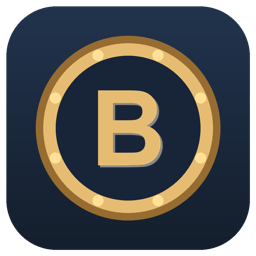
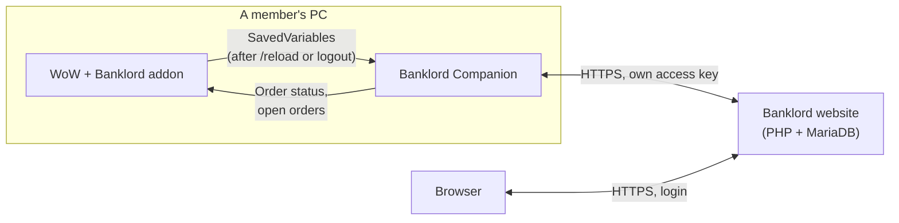

  

<h1 align="center">Banklord</h1>

  <b>Guild bank catalog and ordering system for World of Warcraft</b> 
  In game and in the browser · for all WoW versions with a guild bank · self-hostable

  
  
  

  <a href="#what-is-banklord">Overview</a> ·
  <a href="#quick-start">Quick start</a> ·
  <a href="docs/README.en.md">Documentation</a> ·
  <a href="docs/faq.en.md">FAQ</a> ·
  <a href="docs/neuigkeiten.en.md">What's new</a> ·
  <a href="README.md">Deutsch</a> · <b>English</b>

---

## What is Banklord?

Banklord turns the guild bank into a **shop for the guild**:

- **Members** see the stock, put items in a cart and order – in game or on the website.
- **Bank managers** get a notification, take the order out of the guild bank with one click and send it from the mailbox with the mail already filled in.
- **The website** keeps stock, orders, reservations, restocking and the log together.

No Blizzard login, no game passwords, no bots: Banklord only reads what the addon saves in game.

## What can it do?

| For whom | In game (addon) | In the browser (website) |
|---|---|---|
| **Members** | Search the stock, cart, order, status of your own orders | Catalog with search and icons, cart, wish list, “My orders”, choose the recipient character |
| **Bank managers** | Notice on new orders, “Withdraw” / “Withdraw all” at the guild bank, “Send” / “Send all” at the mailbox, confirm new members in game | Review, reserve, issue or reject orders, inventory, restock list |
| **Guild admins** | – | Members and roles, invitations, log, system and updates |

More features:

- **Several bank managers** work at the same time without an order ever being sent twice ([how it works](docs/bankverwalter.en.md#several-bank-managers)).
- **Several guilds and characters** on one PC; every order belongs to the right character and the right guild.
- **Works with other addons** (combined bank tabs, mailbox addons), because Banklord uses the game API rather than the Blizzard windows.
- **Help & Feedback** in game and on the website: report bugs, suggest ideas, request new languages – with status and answer.
- **German and English**, times always in the user's local time.
- **Signed automatic updates** for website, addon and desktop app.

## How it works

Addons cannot access the internet in game. That is why there is the **Companion**, a small program on the PC: it reads what the addon saved, uploads scans and orders, and writes the current state back into the addon. More in [Installation](docs/installation.en.md#what-gets-installed).

## Quick start

**I am a member of a guild that already uses Banklord**

1. On your guild's website, click **“Download Windows setup”** at the bottom and run it.
2. In the setup, click **“Install / Update”**.
3. Start WoW, log in, `/reload` once. A bank manager who is online confirms you automatically; the Companion opens and you click **“Connect”**.
4. Set an e-mail and password for the website once – done.

➜ In detail: [Guide for members](docs/mitglieder.en.md)

**I am a bank manager** ➜ [Guide for bank managers](docs/bankverwalter.en.md)

**I want to set up Banklord for my guild** ➜ [Self-hosting](docs/selbst-hosten.en.md)

## Supported versions

| Game | Guild bank | Status |
|---|---|---|
| Mists of Pandaria Classic | yes | in daily use |
| Burning Crusade Anniversary / Classic | yes | supported |
| Retail (The War Within / Midnight) | yes | supported |
| WoW Forever | yes | supported since 1.9 (realmless; please report problems) |
| Classic Era / Hardcore | no | addon loads, orders without guild bank features |

Every guild has one game version. One account can have guilds in several versions; their data is never mixed.

| Desktop app | Status |
|---|---|
| Windows 10/11 (x64) | Setup with all features |
| macOS (Apple Silicon, Intel), Linux (x64) | Beta: setup, Companion and Updater |

## Documentation

| Topic | Content |
|---|---|
| [Members](docs/mitglieder.en.md) | Install, unlock, order, in-game commands |
| [Bank managers](docs/bankverwalter.en.md) | Notifications, withdraw, send, several managers, confirm members |
| [Installation](docs/installation.en.md) | What gets installed, Windows warning, updates, uninstalling, troubleshooting |
| [Self-hosting](docs/selbst-hosten.en.md) | Set up your own website, updates, backups |
| [Security](docs/sicherheit.en.md) | Which data goes where and how it is protected |
| [FAQ](docs/faq.en.md) | Frequently asked questions |
| [What's new](docs/neuigkeiten.en.md) | What is done, what is planned |
| [Development](docs/entwicklung.en.md) | Code structure, running locally, tests, own releases |

## Contributing and help

- Bug, idea or language request? Easiest via **Help & Feedback** in game or on the website – or as an [issue on GitHub](https://github.com/lastrevolution0410/banklord/issues/new/choose).
- Security problem? Please do **not** report it publicly; follow [SECURITY.md](SECURITY.md).
- Contributions are welcome: [CONTRIBUTING.md](CONTRIBUTING.md). Issues and pull requests in English or German.

## License

Copyright © 2026 Björn Thiel Ebert.

Banklord is **source-available** under [CC BY-NC-ND 4.0](LICENSE) with [additional permissions](LICENSE-ADDITIONAL-PERMISSIONS.md):

- ✅ Use it free of charge for your own guild or community and self-host it, configure it, run your own signed update channel, contribute bug fixes and translations.
- ❌ Sell it or offer it as a paid service, publish modified versions or forks under another name.

World of Warcraft and Blizzard Entertainment are trademarks of Blizzard Entertainment, Inc. Banklord is an independent, non-commercial fan project and is not affiliated with Blizzard. Notes on third-party data: [NOTICE.md](NOTICE.md).
