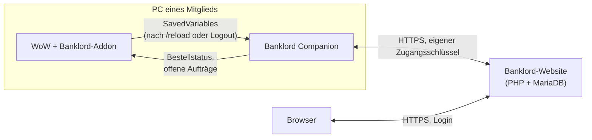

  

<h1 align="center">Banklord</h1>

  <b>Gildenbank-Katalog und Bestellsystem für World of Warcraft</b> 
  Im Spiel und im Browser · für alle WoW-Versionen mit Gildenbank · selbst hostbar

  
  
  

  <a href="#was-ist-banklord">Überblick</a> ·
  <a href="#schnellstart">Schnellstart</a> ·
  <a href="docs/README.md">Dokumentation</a> ·
  <a href="docs/faq.md">FAQ</a> ·
  <a href="#english">English</a>

---

## Was ist Banklord?

Banklord macht aus der Gildenbank einen **Laden für die Gilde**:

- **Mitglieder** sehen den Bestand, legen Gegenstände in einen Warenkorb und bestellen – im Spiel oder auf der Website.
- **Bankverwalter** bekommen eine Benachrichtigung, nehmen die Bestellung mit einem Klick aus der Gildenbank und schicken sie am Briefkasten mit vorausgefülltem Brief ab.
- **Die Website** hält Bestand, Bestellungen, Reservierungen, Nachkauf und Protokoll zusammen.

Kein Blizzard-Login, keine Passwörter fürs Spiel, keine Bots: Banklord liest nur, was das Addon im Spiel speichert.

## Was kann es?

| Für wen | Im Spiel (Addon) | Im Browser (Website) |
|---|---|---|
| **Mitglieder** | Bestand durchsuchen, Warenkorb, bestellen, Status der eigenen Bestellungen | Katalog mit Suche und Icons, Warenkorb, Merkliste, „Meine Bestellungen“, Empfänger-Charakter wählen |
| **Bankverwalter** | Hinweis bei neuer Bestellung, „Entnehmen“ / „Alle entnehmen“ an der Gildenbank, „Versenden“ / „Alle versenden“ am Briefkasten, neue Mitglieder im Spiel bestätigen | Aufträge prüfen, reservieren, ausgeben oder ablehnen, Inventur, Nachkauf-Liste |
| **Gilden-Admins** | – | Mitglieder und Rollen, Einladungen, Protokoll, System und Updates |

Weitere Eigenschaften:

- **Mehrere Bankverwalter** arbeiten gleichzeitig, ohne dass eine Bestellung doppelt verschickt wird ([wie das funktioniert](docs/bankverwalter.md#mehrere-bankverwalter)).
- **Mehrere Gilden und Charaktere** auf einem PC; jede Bestellung gehört zum richtigen Charakter und zur richtigen Gilde.
- **Verträgt sich mit anderen Addons** (zusammengefasste Bankfächer, Postfach-Addons), weil Banklord die Spiel-API nutzt und nicht die Blizzard-Fenster.
- **Deutsch und Englisch**, Zeiten immer in der Ortszeit des Nutzers.
- **Signierte automatische Updates** für Website, Addon und Desktop-App.

## So funktioniert es

Das Addon darf im Spiel nicht ins Internet. Deshalb gibt es den **Companion**, ein kleines Programm auf dem PC: Er liest, was das Addon gespeichert hat, lädt Scans und Bestellungen hoch und schreibt den aktuellen Stand zurück ins Addon. Mehr dazu in [Installation](docs/installation.md#was-wird-installiert).

## Schnellstart

**Ich bin Mitglied einer Gilde, die Banklord schon nutzt**

1. Auf der Website deiner Gilde unten **„Windows-Setup herunterladen“** und starten.
2. Im Setup **„Installieren / Aktualisieren“** klicken.
3. WoW starten, einloggen, einmal `/reload`. Ein Bankverwalter, der online ist, bestätigt dich automatisch; der Companion öffnet sich und du klickst **„Verbinden“**.
4. Einmalig E-Mail und Passwort für die Website festlegen – fertig.

➜ Ausführlich: [Anleitung für Mitglieder](docs/mitglieder.md)

**Ich bin Bankverwalter** ➜ [Anleitung für Bankverwalter](docs/bankverwalter.md)

**Ich möchte Banklord für meine Gilde einrichten** ➜ [Selbst hosten](docs/selbst-hosten.md)

## Unterstützte Versionen

| Spiel | Gildenbank | Status |
|---|---|---|
| Mists of Pandaria Classic | ja | im täglichen Einsatz |
| Burning Crusade Anniversary / Classic | ja | unterstützt |
| Retail (The War Within / Midnight) | ja | unterstützt |
| Classic Era / Hardcore | nein | Addon lädt, Bestellungen ohne Gildenbank-Funktionen |

| Desktop-App | Status |
|---|---|
| Windows 10/11 (x64) | Setup mit allen Funktionen |
| macOS (Apple Silicon, Intel), Linux (x64) | Beta: Setup, Companion und Updater |

## Dokumentation

| Thema | Inhalt |
|---|---|
| [Mitglieder](docs/mitglieder.md) | Installieren, freischalten, bestellen, Befehle im Spiel |
| [Bankverwalter](docs/bankverwalter.md) | Benachrichtigungen, Entnehmen, Versenden, mehrere Verwalter, Mitglieder bestätigen |
| [Installation](docs/installation.md) | Was installiert wird, Windows-Warnung, Updates, Deinstallation, Fehlerhilfe |
| [Selbst hosten](docs/selbst-hosten.md) | Eigene Website einrichten, Updates, Backups |
| [Sicherheit](docs/sicherheit.md) | Welche Daten wohin gehen und wie sie geschützt sind |
| [FAQ](docs/faq.md) | Häufige Fragen |
| [Entwicklung](docs/entwicklung.md) | Aufbau des Codes, lokal starten, Tests, eigene Releases |

## Mitmachen und Hilfe

- Fehler oder Wunsch? [Issue anlegen](https://github.com/lastrevolution0410/banklord/issues/new/choose).
- Sicherheitsproblem? Bitte **nicht** öffentlich melden, sondern wie in [SECURITY.md](SECURITY.md) beschrieben.
- Beiträge sind willkommen: [CONTRIBUTING.md](CONTRIBUTING.md).

## Lizenz

Copyright © 2026 Björn Thiel Ebert.

Banklord ist **quelloffen einsehbar** unter [CC BY-NC-ND 4.0](LICENSE) mit [zusätzlichen Erlaubnissen](LICENSE-ADDITIONAL-PERMISSIONS.md):

- ✅ Kostenlos für die eigene Gilde oder Community nutzen und selbst hosten, konfigurieren, eigenen signierten Update-Kanal betreiben, Fehlerbehebungen und Übersetzungen beitragen.
- ❌ Verkaufen oder als kostenpflichtigen Dienst anbieten, veränderte Versionen oder Forks unter anderem Namen veröffentlichen.

World of Warcraft und Blizzard Entertainment sind Marken der Blizzard Entertainment, Inc. Banklord ist ein unabhängiges, nichtkommerzielles Fanprojekt und steht in keiner Verbindung zu Blizzard. Hinweise zu Daten Dritter: [NOTICE.md](NOTICE.md).

---

## English

**Banklord** turns a World of Warcraft guild bank into a shop for the guild. Members browse the bank and order items in game or on a website; bank managers get notified, take orders out of the guild bank with one click and send them from the mailbox with the mail already filled in. Several bank managers can work at the same time without ever sending an order twice.

It consists of an **in-game addon** (Lua), a **website** (PHP 8.2 + MariaDB/MySQL) and a **desktop app** (Go) that installs the addon, keeps everything updated (signed Ed25519 releases) and runs the **Companion**, which carries data between the game and the website, because addons cannot access the network.

- Supported: MoP Classic, Burning Crusade Anniversary/Classic, Retail; Classic Era loads without guild bank features.
- Self-hosting: see [docs/selbst-hosten.md](docs/selbst-hosten.md) (German; the steps are short: upload `backend/`, point the document root to `backend/public`, open the site and follow the setup page).
- Development: `cd dev && docker compose up -d`, then `sh dev/run-tests.sh`. Details in [docs/entwicklung.md](docs/entwicklung.md).
- Issues and pull requests are welcome in English or German. Security reports: [SECURITY.md](SECURITY.md).
- License: CC BY-NC-ND 4.0 with additional permissions (free self-hosting for your own guild; no selling, no renamed forks).
