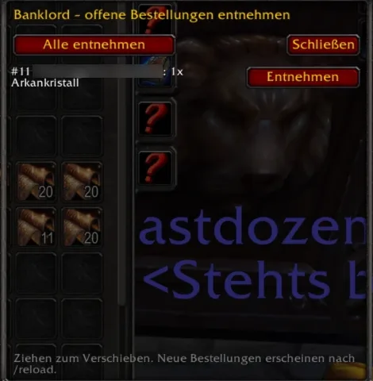
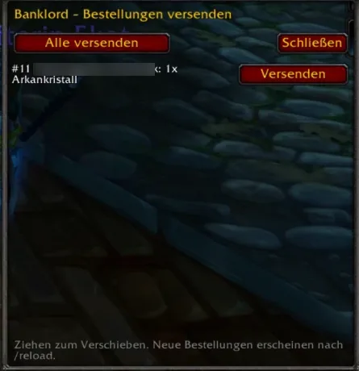
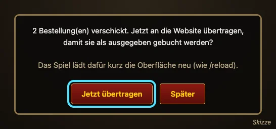
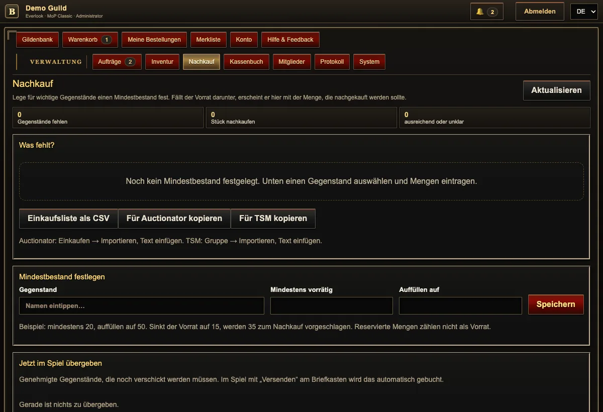
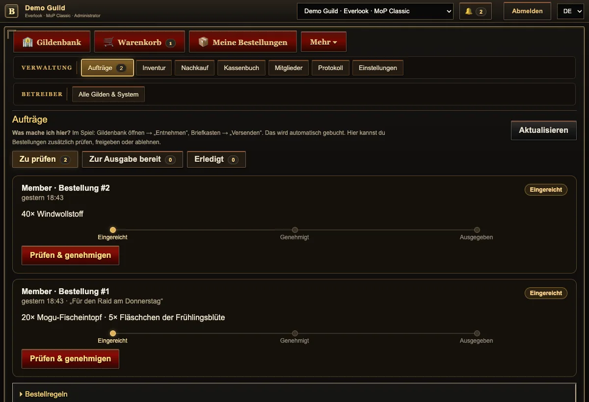
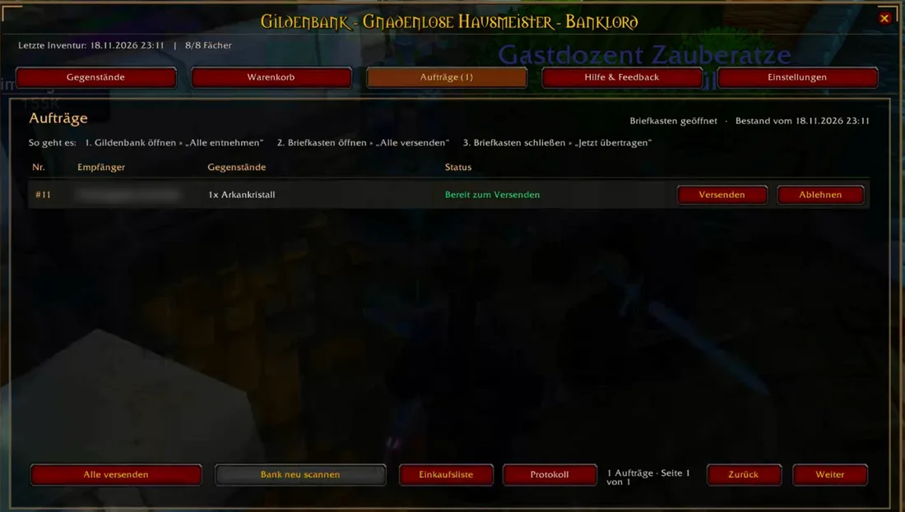
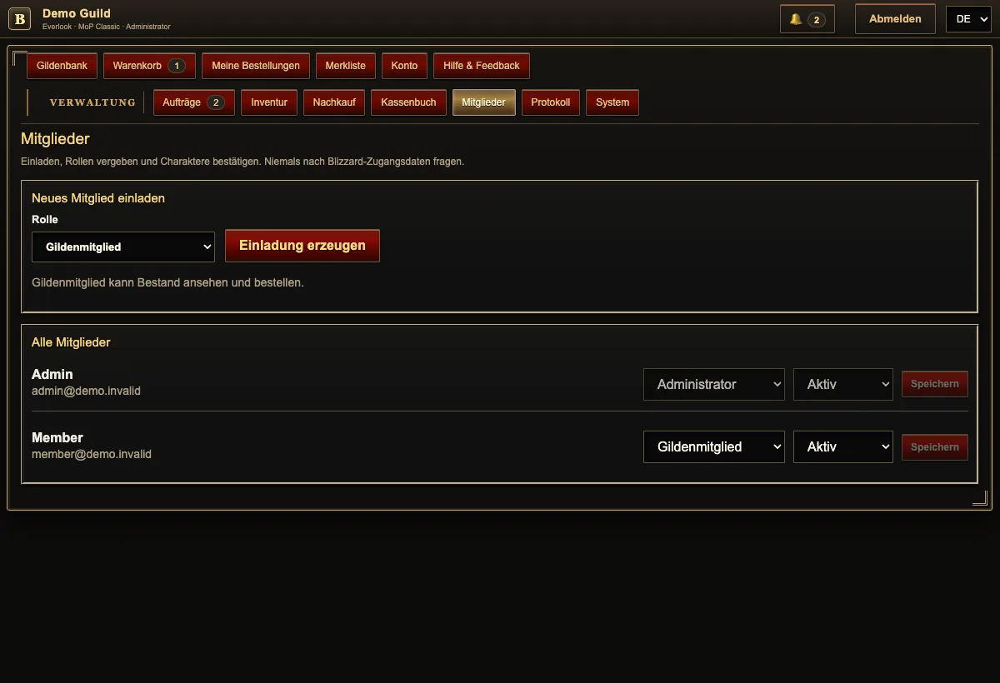
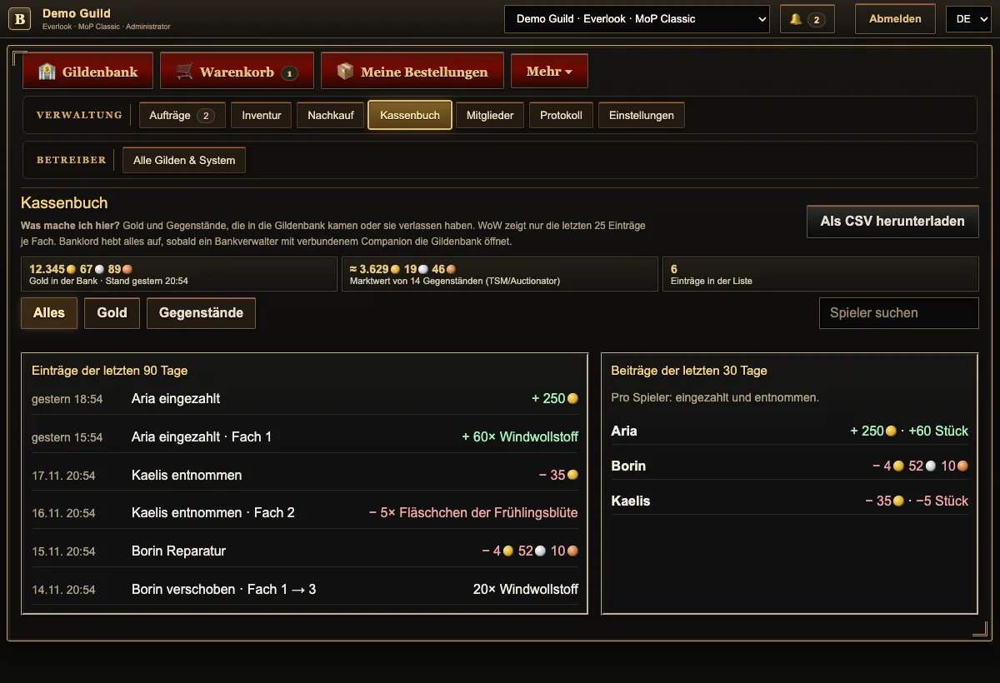

# Guide for bank managers

[← Overview](README.en.md) · [Deutsch](bankverwalter.md) · **English**

This guide applies to everyone with the role **bank manager**, **officer** or **admin**. Set up as in the [guide for members](mitglieder.en.md#set-up-once); an admin assigns the role on the website under **Members**.

## Contents

1. [In short: your routine in 3 steps](#in-short-your-routine-in-3-steps)
1. [Noticing new orders](#noticing-new-orders)
2. [At the guild bank: withdraw](#at-the-guild-bank-withdraw)
3. [At the mailbox: send](#at-the-mailbox-send)
4. [Several bank managers](#several-bank-managers)
5. [Confirming new members](#confirming-new-members)
6. [On the website](#on-the-website)
7. [Cash book, bank value and Discord](#cash-book-bank-value-and-discord)
8. [Together with other addons](#together-with-other-addons)

---

## In short: your routine in 3 steps

That is all you need day to day. Banklord does the rest.

### 1. At the guild bank: “Withdraw all”

Open the guild bank. Banklord appears next to it with all open orders. Click **“Withdraw all”** – Banklord puts exactly the ordered amounts into your bags. Urgent orders are at the top with a red **!**.

### 2. At the mailbox: “Send all”

Open a mailbox and click **“Send all”**. Banklord fills in recipient, subject and attachments; you only click **“Send”** for each letter.

### 3. Close the mailbox: “Transfer now”

When you close it, Banklord asks whether to transfer the sent orders to the website. Click **“Transfer now”** – done. Members see “sent” right away.

> **New members:** While you are online your addon confirms new members by itself. A window then asks whether to transfer the confirmation – just click **“Transfer now”** (outside of combat).

*The sketches show the German interface; in English the buttons are labelled accordingly.*

## Noticing new orders

- **Live:** If a member orders in game while you are online, you get a chat message with a sound and the minimap button blinks with the number of open orders.
- **On login:** Orders received since your last visit (including those from the website) are announced after you log in.
- **List:** `/banklord bestellungen` shows all open orders.

> New orders from the website appear in game after the next `/reload`, because WoW only reads addon data while loading.

## At the guild bank: withdraw

1. Open the guild bank. **“Banklord – withdraw open orders”** appears next to the window.
2. **“Withdraw”** for one order or **“Withdraw all”**.
3. Banklord finds the matching stacks in all tabs, splits stacks if needed and puts exactly the ordered quantity into your bags.
4. If something is missing, chat tells you what and how much. That order is released again.

The window can be moved and remembers its position.

> **Updating the stock:** When you open the guild bank, Banklord scans all tabs automatically. After `/reload` or logout the Companion uploads the scan. If an admin has turned on automatic reconciliation under **System**, the website takes over the scan of every bank manager, officer and admin right away; otherwise it waits under **Inventory** for confirmation.

## At the mailbox: send

1. Open a mailbox. **“Banklord – send orders”** appears.
2. **“Send”** is only active when you have all items of the order in your bags.
3. Banklord fills in the **recipient**, **subject** (`Banklord #<number>`) and **attachments**. You only click **“Send”**.
4. With **“Send all”** the next mail is prepared automatically after each one.
5. After sending, the order counts as issued; the member is notified. When you close the mailbox Banklord offers **“Transfer now”**, then the website is up to date right away.

Only mails Banklord prepared itself count as issued. If you change the subject, nothing is booked.

**Bags full?** Banklord stops, tells you which order is only partly withdrawn, and the next “Withdraw” takes only the rest.

**Partial delivery:** If the stock is not enough, Banklord offers “Take part”. At the mailbox “Send part” mails what is in your bags. Exactly that amount is booked; the rest stays open for every manager.

**Member notice:** After sending, the recipient gets a message in game right away if they are online.

**Weekly limit:** Orders above the limit show “waiting for an officer”. Officers and admins see “Approve” instead (in game or on the website under **Orders**). An admin sets the rules on the website under **Members → Order rules**: weekly limits, automatic cancelling of old orders and view-only tabs.

**Shopping list:** **Orders → Shopping list** (or `/banklord einkauf`) shows what fell below the minimum stock, ready to copy for Auctionator and TSM. Set minimum and target stock on the website under **Restock**; the same lists can be copied there.

**If a member cancels** their order in game, it is locked for you right away.

**Reject:** In the Banklord window under **Orders**, “Reject” next to each order (with confirmation), or `/banklord ablehnen <no>`. Other managers see the order as rejected right away; the website and the member learn about it after your next `/reload`.

---

## Several bank managers

Several managers can work at the same time. **An order is never withdrawn or sent twice**, because the addons coordinate on the guild addon channel:

1. **Reserve:** Before withdrawing or preparing a mail, your addon announces the order as “reserved” and waits 3 seconds for objections.
2. **Simultaneous access:** All addons decide by the same rule. An existing reservation always wins, otherwise the earlier time (server time), and on a tie the alphabetically first name. The other manager sees **“in progress by <name>”** and a locked button.
3. **Lost?** If you had already prepared a mail, it is cleared and you are asked to put the items back.
4. **After sending** your addon reports “sent”. Every Banklord in the guild remembers this for 30 days and tells managers who log in later. Someone who was offline therefore cannot send the order again.
5. **Release:** If items are missing, the reservation is released immediately. A reservation without sending expires after 6 hours.

**What to keep in mind:**

- Coordination requires the addons to hear each other. If nobody with Banklord was online during sending, the website protects as well: after the next upload and `/reload` the order disappears from all lists.
- Sending items **by hand** without the Banklord buttons bypasses the coordination. In that case mark the order as issued on the website.

## Confirming new members

You do not need to do anything. When you are online and a member with a freshly installed Banklord logs in:

1. Your addon checks the name against the **real guild roster** (the sender of an addon message is set by Blizzard's server and cannot be forged).
2. It answers the member with your guild's website address and remembers the confirmation.
3. A window asks **“… was confirmed for Banklord. Transfer to the website now?”** – click **“Transfer now”** (or `/reload` later). Your Companion uploads the confirmation. The website only accepts it from bank managers, officers and admins.
4. The member clicks “Connect” in the Companion and is unlocked.

More about the process and why it is safe: [Security](sicherheit.en.md#unlocking-in-game).

## Set up your own guild

Your guild does not use Banklord yet? Set it up yourself:

1. Sign in on the website (or get an invitation from any Banklord guild and create an account).
2. **Account → “Set up your own guild”:** guild name and realm **exactly as in game**, pick region and game version, “Set up guild”. You are now the guild's administrator.
3. Right below, **“Create personal key”** and paste the code into the **Banklord Companion** – as the first connection or under “More guilds on this PC”.
4. In game, open the **guild bank** with a character of this guild and `/reload`.
5. On the website, approve the first scan under **Inventory**. From now on your members join in game and you confirm them.

The website's operator decides how many guilds an account may set up. If the guild already exists, ask one of its admins for an invitation.

## On the website

Under **Orders** you see all orders with their status, urgent ones first.

In game the same list is under **Orders** – with the three steps on top and “Send” and “Reject” per order:

Under **Members** you invite new members and assign roles.

| Area | Purpose |
|---|---|
| **Orders** | Review all orders, reserve, issue or reject them |
| **Inventory** | Latest guild bank scans, comparison with the stock |
| **Restock** | What is missing or running low |
| **Members** | Assign roles, create invitations, block access (admins) |
| **Log** | Who did what and when |
| **System** | Version, updates, connected devices (admins) |

## Cash book, bank value and Discord

- **Cash book** (website → Management → Cash book): every time you open the guild bank, Banklord reads the bank log – gold and items, who deposited or withdrew what. WoW only shows the last 25 entries per tab; Banklord keeps everything. The Companion uploads it after the next `/reload`. Filter by gold, items or player, download as CSV for spreadsheets. **In game**, **Orders → Activity log** (or `/bl kasse`) shows the gold with coins like in the game and the latest entries – sorted into **Overview** (deposited, withdrawn and balance per player), **Gold** and **Items**.
- **Order history and activity log in game:** the same window has two more tabs for bank managers and officers. **Order history** (`/bl verlauf`) lists the guild's last 40 orders with member, recipient, status and items – including delivered, rejected and cancelled ones. **Activity log** (`/bl protokoll`) shows the same as the website's “Activity”: who ordered, reviewed, mailed or cancelled what and when, new bank scans, joins and rule changes. Both arrive via the Companion when loading; newer entries are on the website.
- **Gold and bank value:** the guild bank's gold is recorded when you open it. With **TSM** or **Auctionator** installed, Banklord records each item's market price. The website then shows the estimated value of the whole bank and per item.
- **Discord** (website → System, administrators only): paste a channel's webhook URL and choose what is announced – new orders, approval needed, sent, below minimum stock. Check it with "Test message".
- **Urgent orders** are marked **“Urgent”** under Orders; in game they have a red **!** before the number and are listed first.

## Together with other addons

Banklord uses the game API directly instead of the Blizzard windows. It therefore also works with addons that show the guild bank as one big tab, or with mailbox addons. If the Banklord window appears in an awkward place, just move it.
