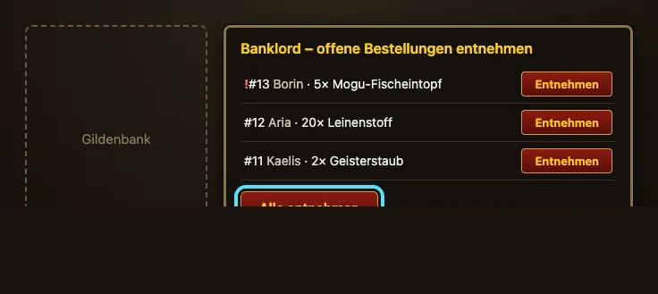
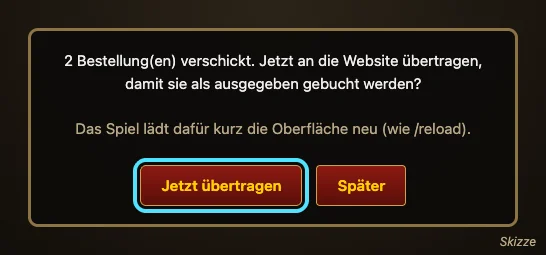
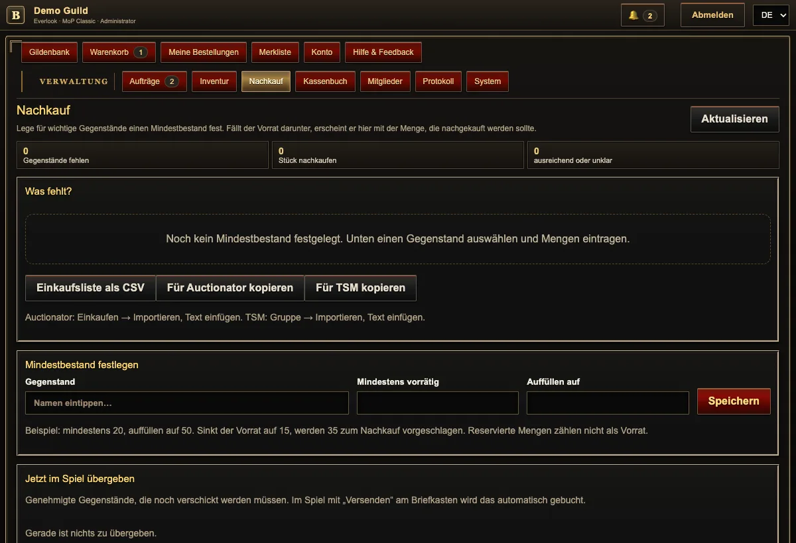
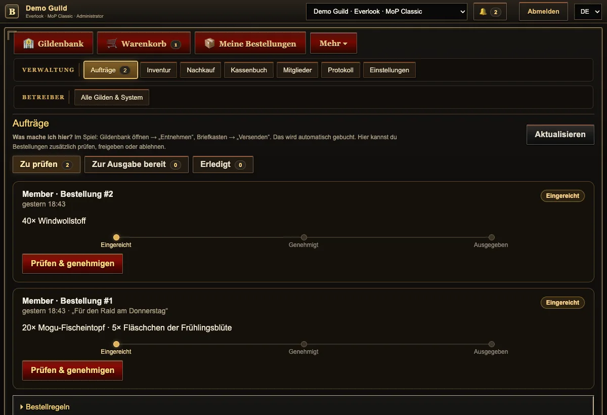
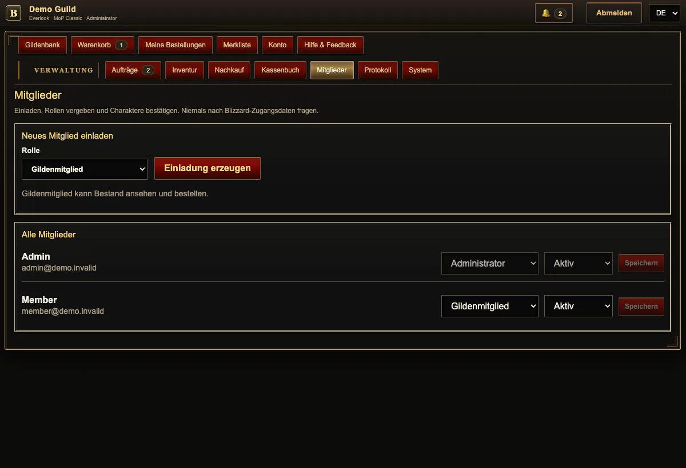
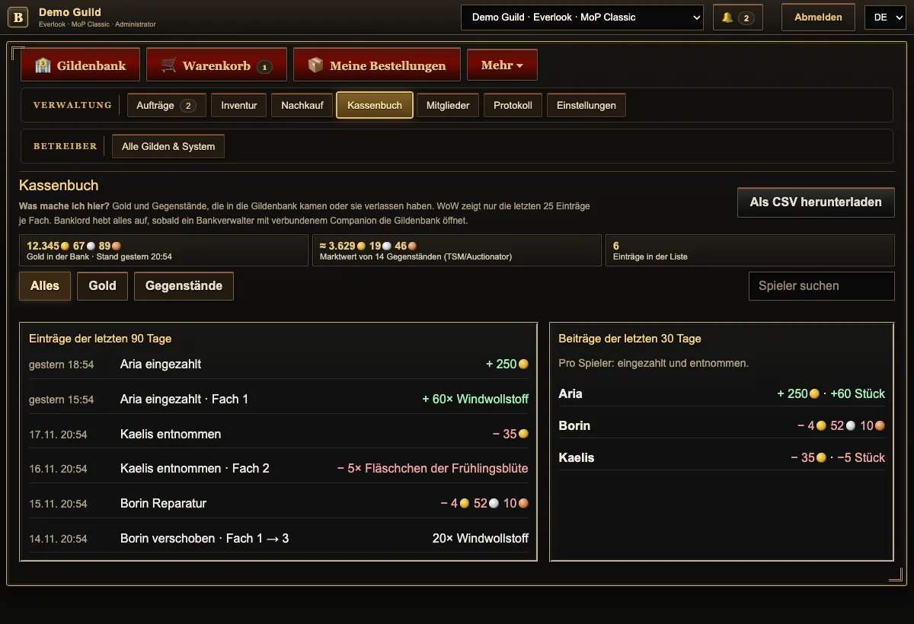

# Anleitung für Bankverwalter

[← Übersicht](README.md) · **Deutsch** · [English](bankverwalter.en.md)

Diese Anleitung gilt für alle mit der Rolle **Bankverwalter**, **Offizier** oder **Admin**. Einrichten wie in der [Anleitung für Mitglieder](mitglieder.md#einmal-einrichten); die Rolle vergibt ein Admin auf der Website unter **Mitglieder**.

## Inhalt

1. [Kurz: Dein Alltag in 3 Schritten](#kurz-dein-alltag-in-3-schritten)
1. [Neue Bestellungen bemerken](#neue-bestellungen-bemerken)
2. [An der Gildenbank: entnehmen](#an-der-gildenbank-entnehmen)
3. [Am Briefkasten: versenden](#am-briefkasten-versenden)
4. [Mehrere Bankverwalter](#mehrere-bankverwalter)
5. [Neue Mitglieder bestätigen](#neue-mitglieder-bestätigen)
6. [Auf der Website](#auf-der-website)
7. [Kassenbuch, Bankwert und Discord](#kassenbuch-bankwert-und-discord)
8. [Zusammen mit anderen Addons](#zusammen-mit-anderen-addons)

---

## Kurz: Dein Alltag in 3 Schritten

Mehr brauchst du im Alltag nicht. Alles andere macht Banklord.

### 1. An der Gildenbank: „Alle entnehmen“

Gildenbank öffnen. Neben dem Fenster erscheint Banklord mit allen offenen Bestellungen. **„Alle entnehmen“** klicken – Banklord legt genau die bestellten Mengen in deine Taschen. Dringende Bestellungen stehen mit rotem **!** ganz oben.

### 2. Am Briefkasten: „Alle versenden“

Briefkasten öffnen, **„Alle versenden“** klicken. Banklord füllt Empfänger, Betreff und Anhänge aus, du klickst bei jedem Brief nur noch **„Senden“**.

### 3. Briefkasten schließen: „Jetzt übertragen“

Beim Schließen fragt Banklord, ob es die verschickten Bestellungen an die Website übertragen soll. **„Jetzt übertragen“** klicken – fertig. Die Mitglieder sehen sofort „verschickt“.

> **Neue Mitglieder:** Wenn du online bist, bestätigt dein Addon neue Mitglieder von selbst. Danach fragt ein Fenster, ob du die Bestätigung übertragen willst – einfach **„Jetzt übertragen“** klicken (außerhalb eines Kampfes).

## Neue Bestellungen bemerken

- **Live:** Bestellt ein Mitglied im Spiel, während du online bist, kommt eine Chatmeldung mit Ton, und der Minikarten-Knopf blinkt mit der Zahl offener Bestellungen.
- **Beim Einloggen:** Bestellungen, die seit deinem letzten Besuch eingegangen sind (auch von der Website), werden nach dem Einloggen angesagt.
- **Liste:** `/banklord bestellungen` zeigt alle offenen Bestellungen.

> Neue Bestellungen von der Website erscheinen im Spiel nach dem nächsten `/reload`, weil WoW Addon-Daten nur beim Laden einliest.

## An der Gildenbank: entnehmen

1. Öffne die Gildenbank. Neben dem Fenster erscheint **„Banklord – offene Bestellungen entnehmen“**.
2. **„Entnehmen“** bei einer Bestellung oder **„Alle entnehmen“**.
3. Banklord sucht die passenden Stapel in allen Fächern, teilt Stapel bei Bedarf und legt genau die bestellte Menge in deine Taschen.
4. Fehlt etwas, steht im Chat, was und wie viel. Diese Bestellung wird wieder freigegeben.

Das Fenster lässt sich verschieben und merkt sich seine Position.

> **Bestand aktualisieren:** Beim Öffnen der Gildenbank scannt Banklord automatisch alle Fächer. Nach `/reload` oder Logout lädt der Companion den Scan hoch. Hat ein Admin unter **System** den automatischen Abgleich eingeschaltet, übernimmt die Website den Scan jedes Bankverwalters, Offiziers und Admins sofort; sonst wartet er unter **Inventur** auf Bestätigung.

## Am Briefkasten: versenden

1. Öffne einen Briefkasten. Es erscheint **„Banklord – Bestellungen versenden“**.
2. **„Versenden“** ist nur aktiv, wenn du alle Gegenstände der Bestellung in den Taschen hast.
3. Banklord füllt **Empfänger**, **Betreff** (`Banklord #<Nummer>`) und die **Anhänge** aus. Du klickst nur noch auf **„Senden“**.
4. Mit **„Alle versenden“** wird nach jedem Brief automatisch der nächste vorbereitet.
5. Nach dem Senden gilt die Bestellung als ausgegeben; das Mitglied wird benachrichtigt. Beim Schließen des Briefkastens bietet Banklord **„Jetzt übertragen“** an, dann ist auch die Website sofort aktuell.

Nur Briefe, die Banklord selbst vorbereitet hat, zählen als Ausgabe. Änderst du den Betreff, wird nichts gebucht.

**Taschen voll?** Banklord stoppt, sagt welche Bestellung erst teilweise entnommen ist, und nimmt beim nächsten „Entnehmen“ nur noch den Rest.

**Teillieferung:** Reicht der Bestand nicht, bietet Banklord „Teil entnehmen“ an. Am Briefkasten verschickst du mit „Teil senden“, was in den Taschen ist. Genau diese Menge wird gebucht, der Rest bleibt für jeden Verwalter offen.

**Mitglied benachrichtigen:** Nach dem Versand bekommt der Empfänger sofort eine Meldung im Spiel, wenn er online ist.

**Wochenlimit:** Bestellungen über dem Limit zeigen „wartet auf einen Offizier“. Offiziere und Administratoren sehen stattdessen „Freigeben“ (im Spiel oder auf der Website unter **Aufträge**). Die Regeln stellt ein Administrator auf der Website unter **Mitglieder → Bestellregeln** ein: Wochenlimits, automatisches Stornieren alter Bestellungen und Nur-ansehen-Tabs.

**Einkaufsliste:** Unter **Aufträge → Einkaufsliste** (oder `/banklord einkauf`) steht, was unter den Mindestbestand gefallen ist – zum Kopieren für Auctionator und TSM. Mindest- und Zielbestand legst du auf der Website unter **Nachkauf** fest; dort gibt es dieselben Listen zum Kopieren.

**Storniert ein Mitglied** seine Bestellung im Spiel, ist sie bei dir sofort gesperrt.

**Ablehnen:** Im Banklord-Fenster unter **Aufträge** neben jeder Bestellung „Ablehnen“ (mit Rückfrage) oder `/banklord ablehnen <Nr>`. Andere Verwalter sehen die Bestellung sofort als abgelehnt; die Website und das Mitglied erfahren es nach deinem nächsten `/reload`.

---

## Mehrere Bankverwalter

Mehrere Verwalter können gleichzeitig arbeiten. **Eine Bestellung wird nie doppelt entnommen oder verschickt**, weil sich die Addons im Gilden-Addon-Kanal absprechen:

1. **Reservieren:** Bevor entnommen oder ein Brief vorbereitet wird, kündigt dein Addon die Bestellung als „reserviert“ an und wartet 3 Sekunden auf Einspruch.
2. **Gleichzeitiger Zugriff:** Alle Addons entscheiden nach derselben Regel. Eine bestehende Reservierung gewinnt immer, sonst die frühere Uhrzeit (Serverzeit), bei Gleichstand der alphabetisch erste Name. Der andere sieht **„in Arbeit bei <Name>“** und einen gesperrten Knopf.
3. **Verloren?** Hattest du schon einen Brief vorbereitet, wird er geleert, und du wirst gebeten, die Gegenstände zurückzulegen.
4. **Nach dem Versand** meldet dein Addon „versendet“. Jedes Banklord in der Gilde merkt sich das 30 Tage und erzählt es Verwaltern, die sich später einloggen. Wer vorher offline war, kann die Bestellung deshalb nicht noch einmal schicken.
5. **Freigabe:** Fehlen Gegenstände, wird die Reservierung sofort freigegeben. Eine Reservierung ohne Versand verfällt nach 6 Stunden.

**Was du beachten solltest:**

- Die Absprache braucht, dass die Addons sich hören. War beim Versand niemand mit Banklord online, schützt zusätzlich die Website: Nach dem nächsten Hochladen und `/reload` verschwindet die Bestellung aus allen Listen.
- Wer Gegenstände **von Hand** ohne die Banklord-Knöpfe verschickt, umgeht die Absprache. Dann die Bestellung auf der Website als ausgegeben markieren.

## Neue Mitglieder bestätigen

Du musst nichts tun. Wenn du online bist und ein Mitglied mit frisch installiertem Banklord einloggt:

1. Dein Addon prüft den Namen gegen die **echte Gildenliste** (der Absender einer Addon-Nachricht wird von Blizzards Server gesetzt und kann nicht gefälscht werden).
2. Es antwortet dem Mitglied mit der Website-Adresse deiner Gilde und merkt sich die Bestätigung.
3. Es erscheint ein Fenster **„… wurde für Banklord bestätigt. Jetzt an die Website übertragen?“** – **„Jetzt übertragen“** klicken (oder später `/reload`). Dein Companion lädt die Bestätigung hoch. Die Website nimmt sie nur von Bankverwaltern, Offizieren und Admins an.
4. Das Mitglied klickt im Companion auf „Verbinden“ und ist freigeschaltet.

Mehr zum Ablauf und warum er sicher ist: [Sicherheit](sicherheit.md#freischaltung-im-spiel).

## Auf der Website

Unter **Aufträge** siehst du alle Bestellungen mit Status, dringende zuerst.

Unter **Mitglieder** lädst du neue Mitglieder ein und vergibst Rollen.

| Bereich | Wofür |
|---|---|
| **Aufträge** | Alle Bestellungen prüfen, reservieren, ausgeben oder ablehnen |
| **Inventur** | Letzte Scans der Gildenbank, Abgleich mit dem Bestand |
| **Nachkauf** | Was fehlt oder knapp ist |
| **Mitglieder** | Rollen vergeben, Einladungen erstellen, Zugänge sperren (Admins) |
| **Protokoll** | Wer hat wann was getan |
| **System** | Version, Updates, verbundene Geräte (Admins) |

## Kassenbuch, Bankwert und Discord

- **Kassenbuch** (Website → Verwaltung → Kassenbuch): Jedes Mal, wenn du die Gildenbank öffnest, liest Banklord das Bankprotokoll aus – Gold und Gegenstände, wer was eingezahlt oder entnommen hat. WoW zeigt nur die letzten 25 Einträge je Fach; Banklord hebt alles auf. Nach dem nächsten `/reload` überträgt der Companion es. Filter nach Gold, Gegenständen oder Spieler, Download als CSV für Tabellen. **Im Spiel** zeigt **Aufträge → Kassenbuch** (oder `/bl kasse`) den Goldstand mit Münzen wie im Spiel und die letzten Einträge – sortiert in **Übersicht** (pro Spieler eingezahlt, entnommen, Saldo), **Gold** und **Gegenstände**.
- **Goldstand und Bankwert:** Der Goldstand der Gildenbank wird beim Öffnen mitgenommen. Hast du **TSM** oder **Auctionator** installiert, nimmt Banklord den Marktpreis jedes Gegenstands mit. Die Website zeigt dann den geschätzten Wert der ganzen Bank und pro Gegenstand.
- **Discord** (Website → System, nur Administratoren): Webhook-URL eines Kanals einfügen und wählen, was gemeldet wird – neue Bestellungen, Freigabe nötig, verschickt, unter Mindestbestand. Mit „Testnachricht“ prüfen.
- **Dringende Bestellungen** sind in Aufträgen mit **„Dringend“** markiert, im Spiel mit einem roten **!** vor der Nummer und stehen oben.

## Zusammen mit anderen Addons

Banklord nutzt die Spiel-API direkt und nicht die Blizzard-Fenster. Deshalb funktioniert es auch mit Addons, die die Gildenbank als ein großes Fach anzeigen, oder mit Postfach-Addons. Erscheint das Banklord-Fenster an einer ungünstigen Stelle, einfach verschieben.
