# Guide for guild leaders

[← Overview](README.en.md) · [Deutsch](gildenleiter.md) · **English**

You want to use Banklord for your guild but don't want to run your own server? Then simply use our website **[banklord.mgc-nom.net](https://banklord.mgc-nom.net)**. It is **free**, you need **no technical knowledge**, and updates arrive on their own. Setting it up takes about **15 minutes**.

> You have your own server and want to run everything yourself? Then read [Self-hosting](selbst-hosten.en.md) instead.

The pictures show the German website; the English one looks the same.

## Contents

1. [What you need](#what-you-need)
2. [Step 1: Register your guild on the website](#step-1-register-your-guild-on-the-website)
3. [Step 2: Install Banklord](#step-2-install-banklord)
4. [Step 3: Connect your PC to the guild](#step-3-connect-your-pc-to-the-guild)
5. [Step 4: Read the guild bank for the first time](#step-4-read-the-guild-bank-for-the-first-time)
6. [Step 5: Bring in your members](#step-5-bring-in-your-members)
7. [Step 6: Appoint helpers](#step-6-appoint-helpers)
8. [Not working?](#not-working)
9. [Good to know](#good-to-know)

---

## What you need

- a **Windows PC** with WoW
- a **character in your guild** who may open the guild bank (ideally guild leader or officer)
- an **e-mail address**

## Step 1: Register your guild on the website

1. Open **[banklord.mgc-nom.net](https://banklord.mgc-nom.net)**.
2. Click the **“Register guild”** tab at the top.
3. Fill in the form:

   | Field | What to enter |
   |---|---|
   | **Guild name** | **exactly as in game** – with upper and lower case and special characters |
   | **Game version** | e.g. Retail, Mists of Pandaria Classic or WoW Forever |
   | **Realm** | exactly as in game (WoW Forever has no realm field) |
   | **Region** | usually **EU** |
   | **Display name** | how others see you on the website |
   | **E-mail and password** | at least 14 characters. **Never your Blizzard password!** Tip: three words with hyphens, e.g. *Dragon-Coffee-Window* |

4. Click **“Create account and guild”**.

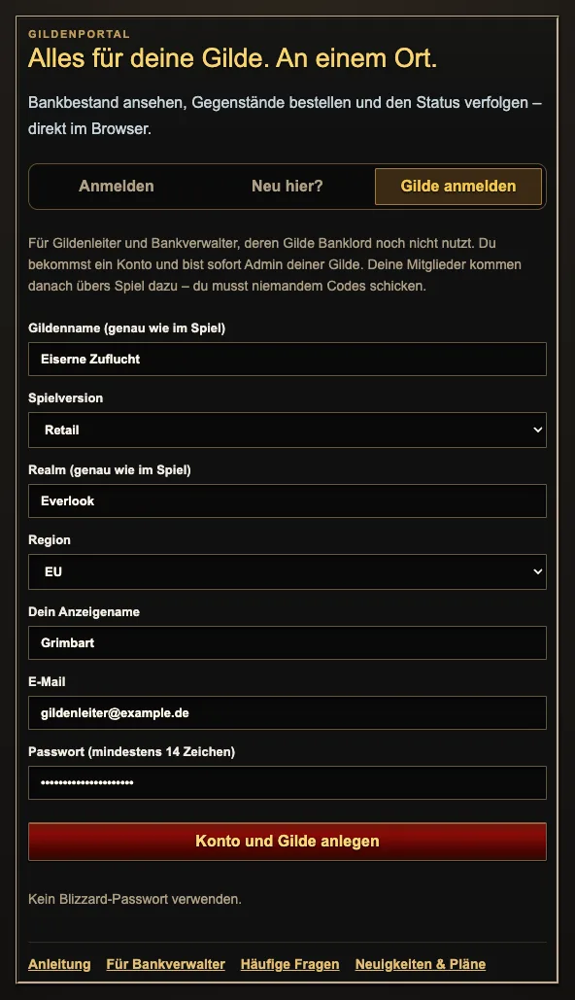

**Done:** you are signed in and **admin** of your guild. The website shows you right away what comes next:

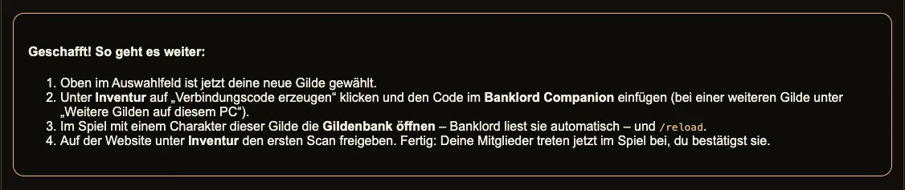

> **No “Register guild” tab?** New sign-ups are closed right now. Please try again later.

## Step 2: Install Banklord

On the start page under **“New here?”** you will find the **“Download Windows setup”** button. If you are already signed in, it is under **More → Account & guilds**.

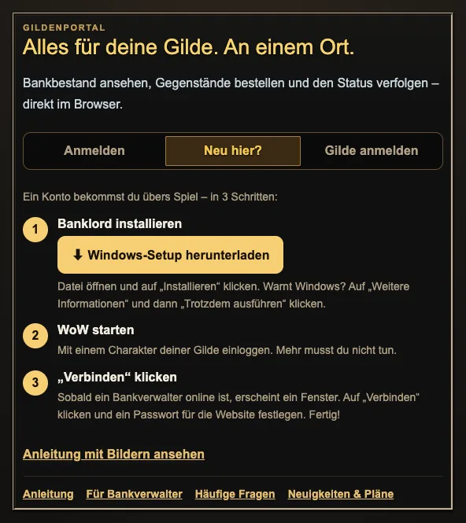

1. Open the file.
2. Windows warns you? Click **“More info”** and then **“Run anyway”**.
3. **WoW must be closed.** Click **“Install / Update”**.

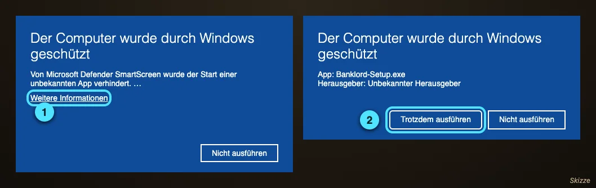


More help with installing: [Installation and troubleshooting](installation.en.md).

## Step 3: Connect your PC to the guild

As the very first one, there is nobody yet who could confirm you in game. So you connect your PC once by hand. It takes a minute:

1. On the website, click **Inventory scan** at the top.
2. In the **“No scan yet.”** box, click **“Create connect code”**.

   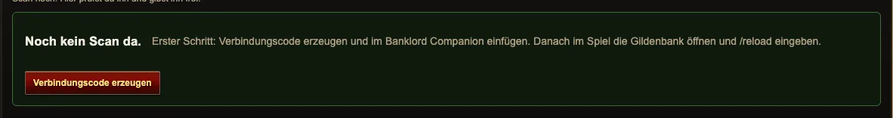

3. It asks for a name for your PC. Just click **“OK”**.
4. Click **“Copy code”**.

   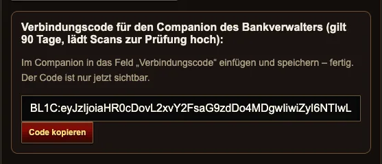

5. Open the **Banklord Companion**. It starts on its own after setup. Otherwise: double-click **Banklord Companion** on your desktop.
6. Click into the **“Verbindungscode”** (connect code) field, paste the code (**Ctrl + V**) and click **“Speichern und verbinden”** (save and start).

   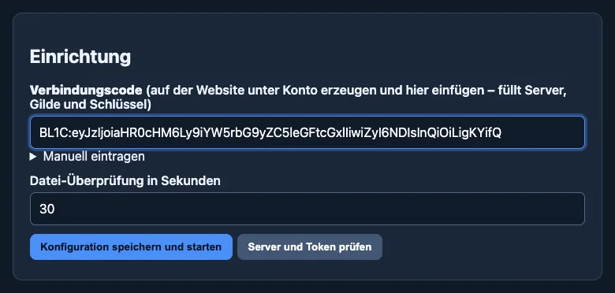

The Companion now shows **“Bereit”** (ready).

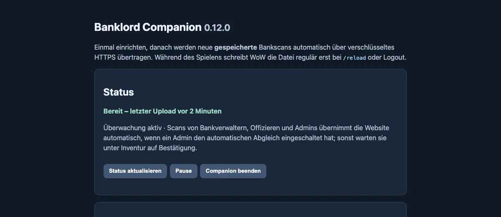

> **Important:** the code is shown only once and is valid for 90 days. Don't give it to anyone. Lost it? Just create a new one under **Inventory scan → Advanced**.

## Step 4: Read the guild bank for the first time

1. Start WoW and log in with a character of your guild.
2. Open the **guild bank**. Banklord reads all tabs on its own.
3. Type `/reload` in chat. Now the Companion sends the stock to the website.
4. On the website: open **Inventory scan**. At the top it says **“1 new scan is waiting for approval”**. Click **“Check now”**.

   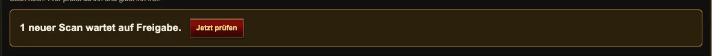

5. Quickly compare the list with the guild bank in game. If everything matches: enter your **website password**, **tick the box**, click **“Accept stock”**.

   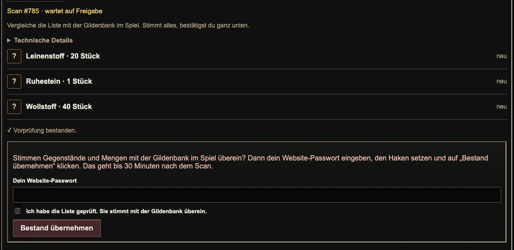

   > This works up to 30 minutes after the scan. Too late? Just open the guild bank again and `/reload`.

From now on everyone sees the guild bank's stock on the website.

> **No bank tab yet** (e.g. a new guild in WoW Forever)? No problem. Banklord tells you once there is a tab. Gold and the cash book already work.

## Step 5: Bring in your members

You don't have to send anyone a code. Just copy this message into your guild chat or Discord:

```
Our guild bank is now online: https://banklord.mgc-nom.net
Click "New here?", install the setup, start WoW - done.
```

What happens next:

1. The member installs Banklord and logs in to the game.
2. **As soon as you (or another bank manager) are online**, your addon confirms the member on its own.
3. A window appears for you: click **“Transfer now”**.

   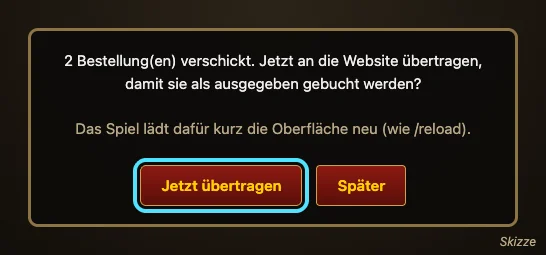

4. The member's Companion opens; they click **“Connect”** and choose a password.

   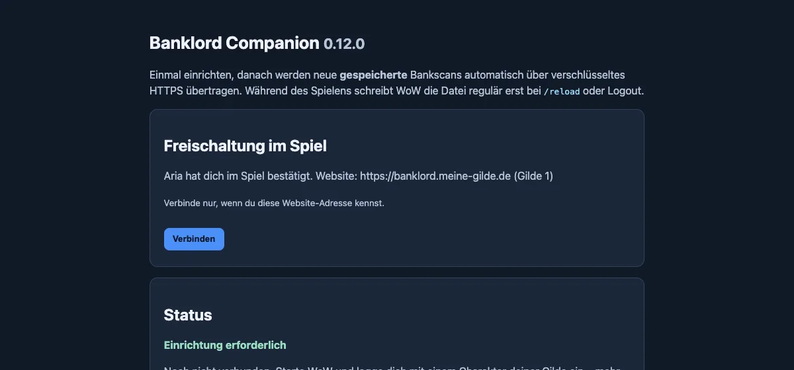

> **Nobody online for a long time?** Under **Members** you can also create an invitation and send the code.

## Step 6: Appoint helpers

Doing it alone is a lot of work. Give trusted people a role: website → **Members** → choose a role.

| Role | May |
|---|---|
| **Member** | view stock, order |
| **Bank manager** | withdraw and send orders, confirm new members |
| **Officer** | also approve large orders |
| **Admin** | everything, including roles, rules and settings |

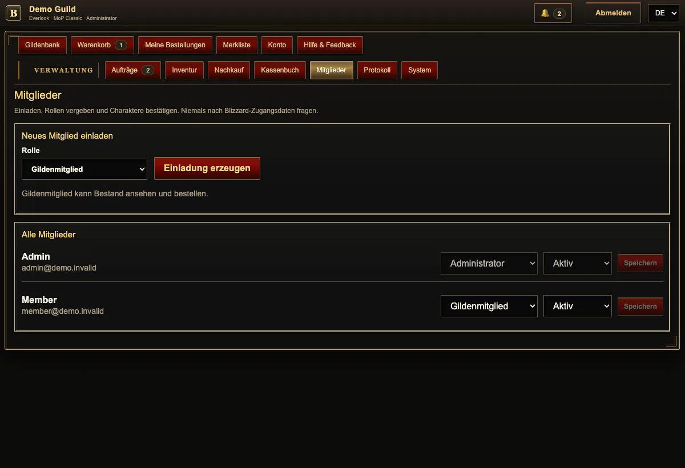

What a new bank manager has to do: [Appointing a new bank manager](bankverwalter.en.md#appointing-a-new-bank-manager). What their day looks like: [Guide for bank managers](bankverwalter.en.md).

## Not working?

| What you see | What you do |
|---|---|
| The website says the guild already exists | Someone from your guild has already registered it. Ask one of its admins for an invitation. |
| The stock stays empty | Open the guild bank, `/reload`, then accept it on the website under **Inventory scan**. |
| Members wait a long time | No bank manager is online. As soon as one comes along, it continues on its own. |
| The Companion says the connect code is invalid | Create a new code under **Inventory scan → Advanced** and paste it again. Copy the whole code, including the `BL1C:` at the start. |
| Forgot your password | Click **“Forgot password?”** on the start page. |

Still stuck? Write to us on the website under **Help & feedback → Report a bug** or in game with `/bl hilfe`.

## Good to know

- **Free:** Banklord is a fan project. There are no costs and no subscription.
- **Your data:** we only store what Banklord needs: e-mail, character names, stock and orders. We never see your Blizzard account. More under [Security](sicherheit.en.md).
- **Updates:** website, addon and Companion keep themselves up to date.
- **Several guilds:** under **More → Account & guilds → “Set up your own guild”** you add more guilds.
- **Frequently asked questions:** [FAQ](faq.en.md)
