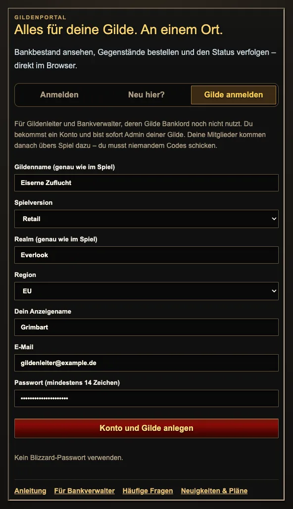
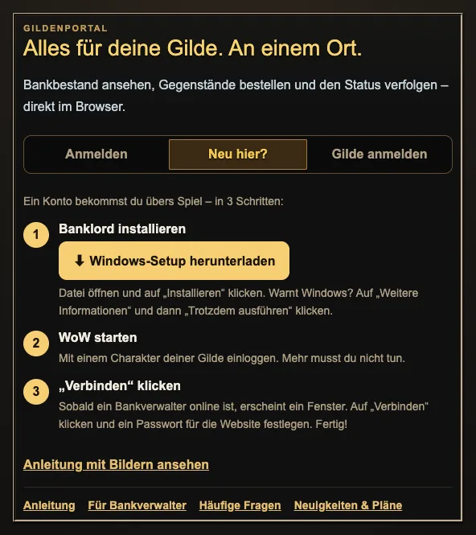
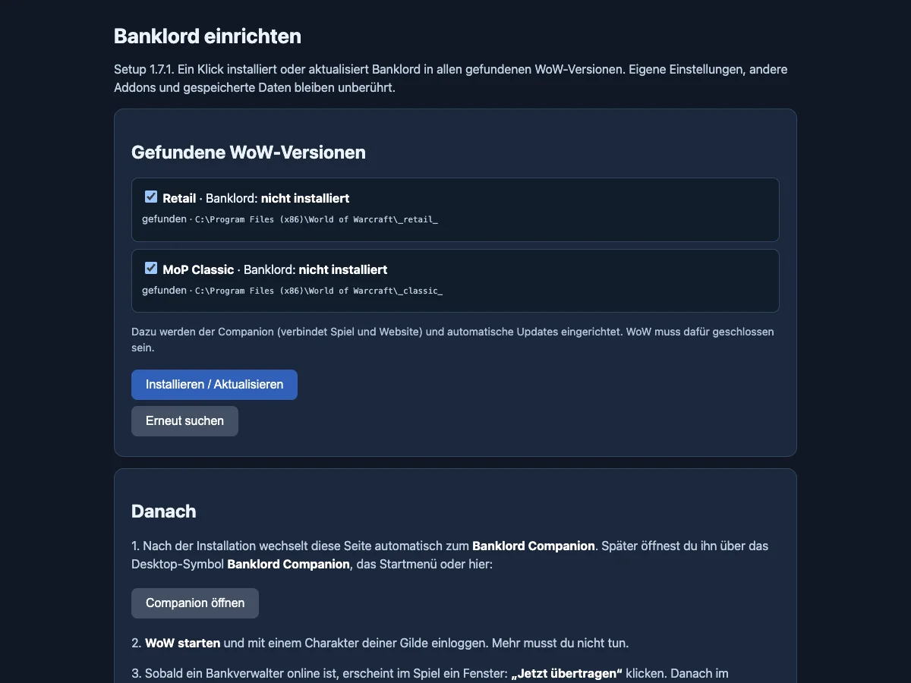
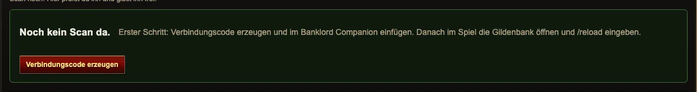
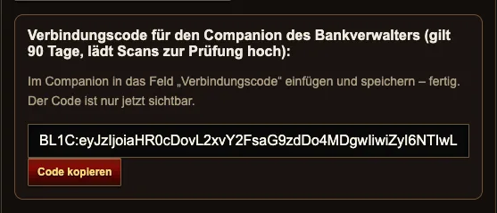
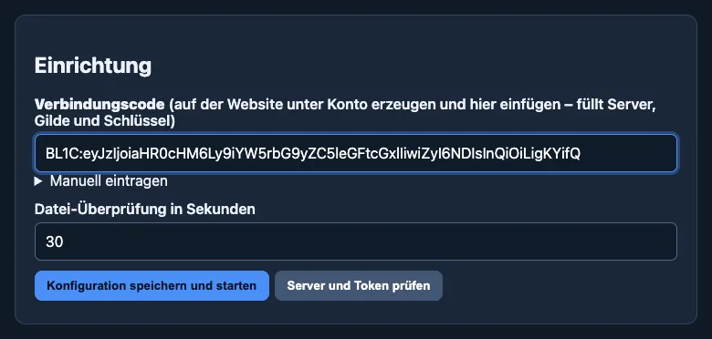
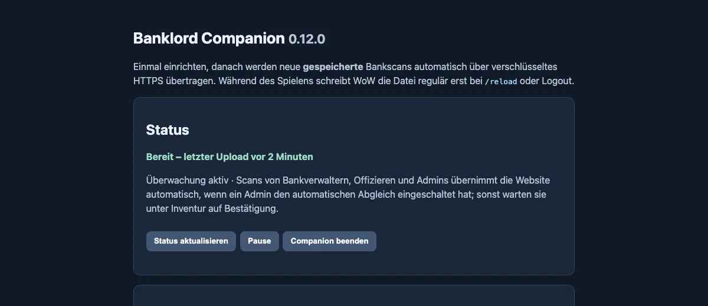
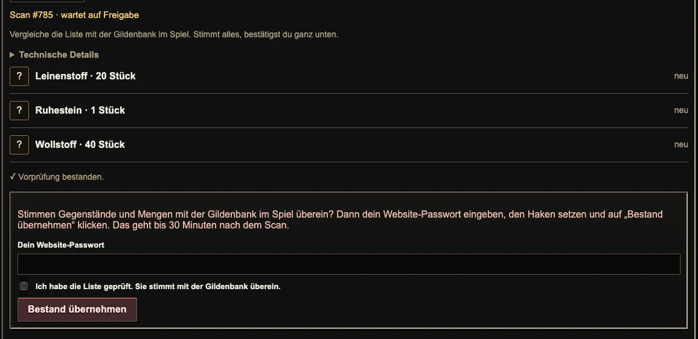
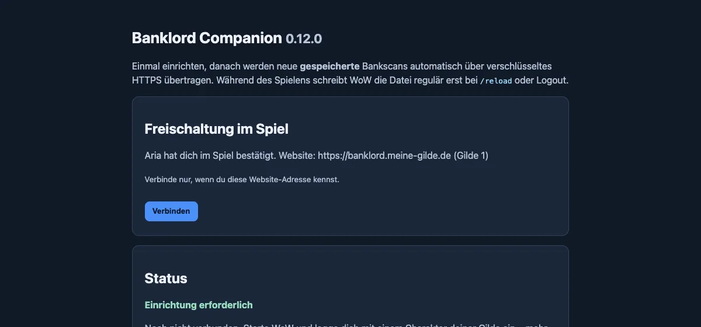
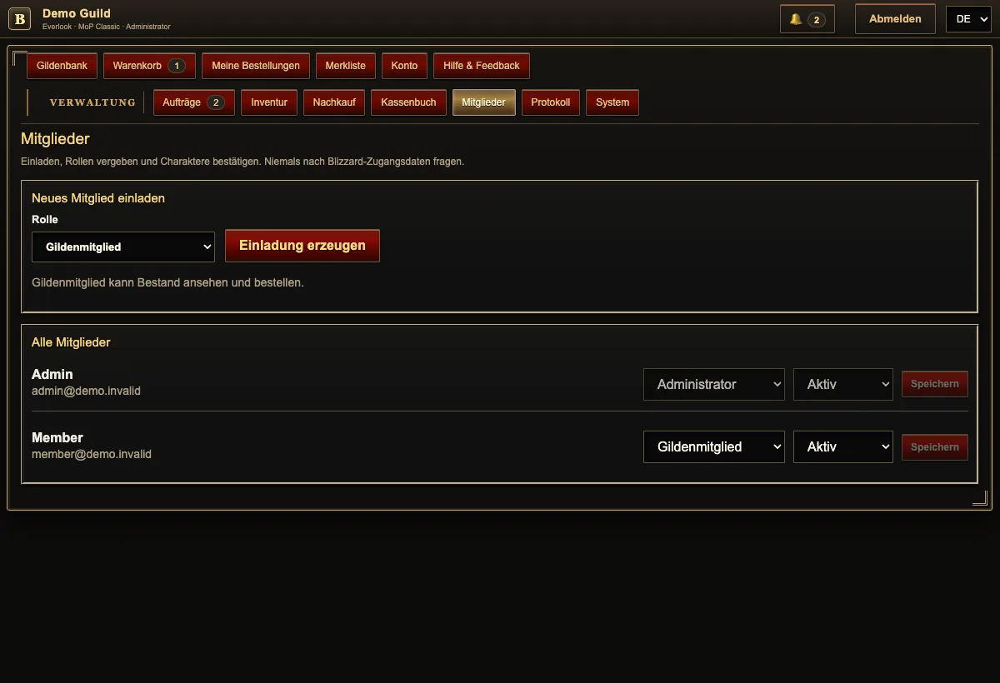

# Anleitung für Gildenleiter

[← Übersicht](README.md) · **Deutsch** · [English](gildenleiter.en.md)

Du willst Banklord für deine Gilde nutzen, aber keinen eigenen Server betreiben? Dann nimm einfach unsere Website **[banklord.mgc-nom.net](https://banklord.mgc-nom.net)**. Sie ist **kostenlos**, du brauchst **keine Technik**, und Updates kommen von selbst. Das Einrichten dauert etwa **15 Minuten**.

> Du hast einen eigenen Server und willst alles selbst betreiben? Dann lies stattdessen [Selbst hosten](selbst-hosten.md).

## Inhalt

1. [Das brauchst du](#das-brauchst-du)
2. [Schritt 1: Gilde auf der Website anmelden](#schritt-1-gilde-auf-der-website-anmelden)
3. [Schritt 2: Banklord installieren](#schritt-2-banklord-installieren)
4. [Schritt 3: Deinen PC mit der Gilde verbinden](#schritt-3-deinen-pc-mit-der-gilde-verbinden)
5. [Schritt 4: Die Gildenbank zum ersten Mal einlesen](#schritt-4-die-gildenbank-zum-ersten-mal-einlesen)
6. [Schritt 5: Mitglieder dazuholen](#schritt-5-mitglieder-dazuholen)
7. [Schritt 6: Helfer ernennen](#schritt-6-helfer-ernennen)
8. [Klappt nicht?](#klappt-nicht)
9. [Gut zu wissen](#gut-zu-wissen)

---

## Das brauchst du

- einen **Windows-PC** mit WoW
- einen **Charakter in deiner Gilde**, der die Gildenbank öffnen darf (am besten Gildenleiter oder Offizier)
- eine **E-Mail-Adresse**

## Schritt 1: Gilde auf der Website anmelden

1. Öffne **[banklord.mgc-nom.net](https://banklord.mgc-nom.net)**.
2. Klicke oben auf den Reiter **„Gilde anmelden“**.
3. Fülle das Formular aus:

   | Feld | Was du einträgst |
   |---|---|
   | **Gildenname** | **genau wie im Spiel** – mit Groß- und Kleinschreibung und Sonderzeichen |
   | **Spielversion** | z. B. Retail, Mists of Pandaria Classic oder WoW Forever |
   | **Realm** | genau wie im Spiel (bei WoW Forever gibt es kein Realm-Feld) |
   | **Region** | meist **EU** |
   | **Anzeigename** | so sehen dich die anderen auf der Website |
   | **E-Mail und Passwort** | mindestens 14 Zeichen. **Nie dein Blizzard-Passwort!** Tipp: drei Wörter mit Bindestrich, z. B. *Drache-Kaffee-Fenster* |

4. Klicke **„Konto und Gilde anlegen“**.



**Fertig:** Du bist angemeldet und **Admin** deiner Gilde. Die Website zeigt dir gleich, wie es weitergeht:


> **Kein Reiter „Gilde anmelden“ zu sehen?** Dann sind neue Anmeldungen gerade geschlossen. Versuch es später noch einmal.

## Schritt 2: Banklord installieren

Auf der Startseite unter **„Neu hier?“** findest du den Knopf **„Windows-Setup herunterladen“**. Bist du schon angemeldet, steht er unter **Mehr → Konto & Gilden**.



1. Datei öffnen.
2. Warnt Windows? **„Weitere Informationen“** und dann **„Trotzdem ausführen“** klicken.
3. **WoW muss geschlossen sein.** **„Installieren / Aktualisieren“** klicken.




Genauere Hilfe zur Installation: [Installation und Fehlerhilfe](installation.md).

## Schritt 3: Deinen PC mit der Gilde verbinden

Bei dir als Erstem gibt es noch niemanden, der dich im Spiel bestätigen kann. Darum verbindest du deinen PC einmal von Hand. Das dauert eine Minute:

1. Auf der Website oben auf **Inventur** klicken.
2. Im Kasten **„Noch kein Scan da.“** auf **„Verbindungscode erzeugen“** klicken.

   

3. Es fragt nach einem Namen für deinen PC. Einfach **„OK“** klicken.
4. Klicke **„Code kopieren“**.

   

5. Öffne den **Banklord Companion**. Er startet nach dem Setup von selbst. Sonst: Doppelklick auf **Banklord Companion** auf dem Desktop.
6. Klicke ins Feld **„Verbindungscode“**, füge den Code ein (**Strg + V**) und klicke **„Konfiguration speichern und starten“**.

   

Der Companion zeigt jetzt **„Bereit“**.



> **Wichtig:** Der Code ist nur einmal sichtbar und gilt 90 Tage. Gib ihn niemandem weiter. Verloren? Einfach unter **Inventur → Erweitert** einen neuen erzeugen.

## Schritt 4: Die Gildenbank zum ersten Mal einlesen

1. Starte WoW und logge dich mit einem Charakter deiner Gilde ein.
2. Öffne die **Gildenbank**. Banklord liest alle Fächer von selbst ein.
3. Tippe im Chat `/reload` ein. Jetzt schickt der Companion den Bestand an die Website.
4. Auf der Website: **Inventur** öffnen. Oben steht **„1 neuer Scan wartet auf Freigabe“**. Klicke **„Jetzt prüfen“**.

   

5. Vergleiche die Liste kurz mit der Gildenbank im Spiel. Stimmt alles: **Website-Passwort** eingeben, **Haken setzen**, **„Bestand übernehmen“** klicken.

   

   > Das geht bis 30 Minuten nach dem Scan. Zu spät? Einfach die Gildenbank noch einmal öffnen und `/reload`.

Ab jetzt sehen alle den Bestand der Gildenbank auf der Website.

> **Noch kein Bankfach** (z. B. eine neue Gilde in WoW Forever)? Kein Problem. Banklord meldet sich, sobald es ein Fach gibt. Gold und das Kassenbuch funktionieren schon jetzt.

## Schritt 5: Mitglieder dazuholen

Du musst niemandem einen Code schicken. Kopiere einfach diese Nachricht in deinen Gilden-Chat oder Discord:

```
Unsere Gildenbank gibt es jetzt online: https://banklord.mgc-nom.net
Dort auf "Neu hier?" klicken, Setup installieren, WoW starten - fertig.
```

So geht es weiter:

1. Das Mitglied installiert Banklord und loggt sich im Spiel ein.
2. **Sobald du (oder ein anderer Bankverwalter) online bist**, bestätigt dein Addon das Mitglied von selbst.
3. Bei dir erscheint ein Fenster: **„Jetzt übertragen“** klicken.

   

4. Beim Mitglied öffnet sich der Companion, es klickt **„Verbinden“** und legt ein Passwort fest.

   

> **Lange niemand online?** Unter **Mitglieder** kannst du auch eine Einladung erstellen und den Code verschicken.

## Schritt 6: Helfer ernennen

Allein ist es viel Arbeit. Gib vertrauenswürdigen Leuten eine Rolle: Website → **Mitglieder** → Rolle wählen.

| Rolle | Darf |
|---|---|
| **Mitglied** | Bestand ansehen, bestellen |
| **Bankverwalter** | Bestellungen entnehmen und verschicken, neue Mitglieder bestätigen |
| **Offizier** | zusätzlich große Bestellungen freigeben |
| **Admin** | alles, auch Rollen, Regeln und Einstellungen |



Wie der Alltag als Bankverwalter aussieht: [Anleitung für Bankverwalter](bankverwalter.md).

## Klappt nicht?

| Was du siehst | Was du tust |
|---|---|
| Die Website sagt, die Gilde gibt es schon | Jemand aus deiner Gilde hat sie schon angemeldet. Bitte einen ihrer Admins um eine Einladung. |
| Der Bestand bleibt leer | Gildenbank öffnen, `/reload`, dann auf der Website unter **Inventur** übernehmen. |
| Mitglieder warten lange | Es ist kein Bankverwalter online. Sobald einer kommt, geht es von selbst weiter. |
| Der Companion sagt „Verbindungscode ungültig“ | Unter **Inventur → Erweitert** einen neuen Code erzeugen und erneut einfügen. Den ganzen Code kopieren, auch den Anfang `BL1C:`. |
| Passwort vergessen | Auf der Startseite **„Passwort vergessen?“** klicken. |

Hilft das nicht, schreib uns auf der Website unter **Hilfe & Feedback → Fehler melden** oder im Spiel mit `/bl hilfe`.

## Gut zu wissen

- **Kostenlos:** Banklord ist ein Fanprojekt. Es gibt keine Kosten und kein Abo.
- **Deine Daten:** Wir speichern nur, was Banklord braucht: E-Mail, Charakternamen, Bestand und Bestellungen. Dein Blizzard-Konto sehen wir nie. Mehr dazu unter [Sicherheit](sicherheit.md).
- **Updates:** Website, Addon und Companion halten sich selbst aktuell.
- **Mehrere Gilden:** Unter **Mehr → Konto & Gilden → „Eigene Gilde anlegen“** legst du weitere Gilden an.
- **Häufige Fragen:** [FAQ](faq.md)
