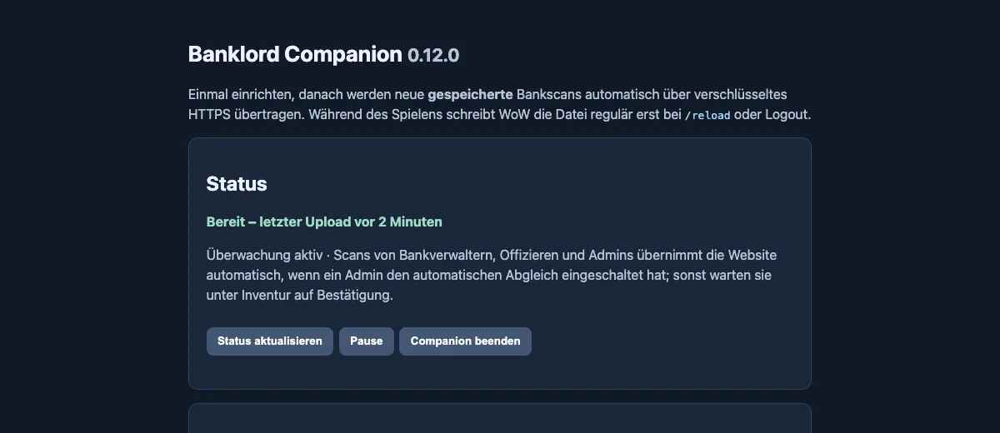

# Installation, updates and troubleshooting

[← Overview](README.en.md) · [Deutsch](installation.md) · **English**

## Contents

1. [What gets installed?](#what-gets-installed)
2. [Windows warns about an unknown app](#windows-warns-about-an-unknown-app)
3. [Updates](#updates)
4. [Uninstalling](#uninstalling)
5. [macOS and Linux](#macos-and-linux)
6. [Troubleshooting](#troubleshooting)

---

## What gets installed?

| Part | Where | Purpose |
|---|---|---|
| **Addon** | `World of Warcraft\<version>\Interface\AddOns\Banklord` | Banklord in game. Installed for every WoW version found and set to that game version. |
| **Companion** | `%LOCALAPPDATA%\Banklord\Companion` | Carries data between addon and website. Starts with Windows, runs invisibly in the background. Controlled in the browser. |
| **Updater** | `%LOCALAPPDATA%\Banklord\Updater` | Regularly checks for signed updates and installs them. Runs invisibly. |

There is **one** shortcut on the desktop and in the Start menu: **Banklord Companion**. It opens the Companion page in your browser (connection, status, other guilds, unlocking). The Companion keeps running without an open window.

Checking for new versions **always runs automatically**: when Windows starts, every few seconds for new releases, at the latest every 2 minutes, and right after WoW closes. You start WoW as usual through Battle.net.

Banklord needs **no administrator rights**, no Blizzard credentials, and changes nothing in the game except its own addon folder.

## Windows warns about an unknown app

On first launch Windows shows “Windows protected your PC”. This is because Banklord is a fan project without a purchased code-signing certificate – not because anything harmful was found.

**“More info” → “Run anyway”.**

 The warning only appears for the setup. Updates check their own digital signature (Ed25519) and then run without a warning.

Only ever download the setup from your guild's website or the [GitHub releases](https://github.com/lastrevolution0410/banklord/releases).

## Updates

- **Addon, Companion, Updater:** automatically through the Updater. Every update is signed; tampered or older packages are rejected. A new addon version becomes active in game from the next game start.
- **Website:** updates itself (see [Self-hosting](selbst-hosten.en.md#updates)).
- **By hand:** run the setup again and click “Install / Update”. This also repairs damaged files.

## Uninstalling

Start the setup → **“Advanced”** → **“Uninstall”**. Removes addon, Companion, Updater, autostart and shortcuts. Your saved game data (`WTF` folder) is kept.

## macOS and Linux

For macOS (Apple Silicon and Intel) and Linux (x64) there are separate downloads on the website under **“Other systems”** (beta). Credentials are stored in the Keychain (macOS) or the Secret Service (Linux).

---

## Troubleshooting

| Problem | Solution |
|---|---|
| Orders or stock in game are out of date | `/reload` – WoW only reads addon data while loading. |
| My order does not reach the website | `/reload` or log out after ordering. Is the Companion running? Open the “Banklord Companion” shortcut and check the status. |
| Cannot find the Companion window | **“Banklord Companion”** shortcut on the desktop or in the Start menu. |
| “Not confirmed yet” when unlocking | A bank manager has to be online and then do one `/reload`. The Companion keeps retrying automatically. |
| No recipient can be chosen in the website cart | Log in with the character once, `/reload`, wait a moment. |
| Addon shows as “out of date” in game | Run the setup again or wait until the Updater has updated. “Load out of date AddOns” in the addon menu is not needed. |
| Something else | Report a bug – see [FAQ](faq.en.md#how-do-i-report-a-bug). |
