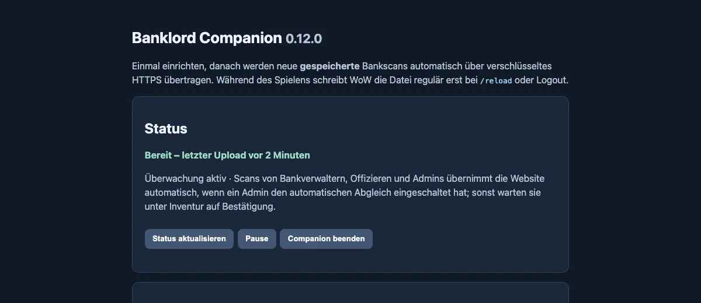

# Installation, Updates und Fehlerhilfe

[← Übersicht](README.md) · **Deutsch** · [English](installation.en.md)

## Inhalt

1. [Was wird installiert?](#was-wird-installiert)
2. [Windows warnt vor einer unbekannten App](#windows-warnt-vor-einer-unbekannten-app)
3. [Updates](#updates)
4. [Deinstallieren](#deinstallieren)
5. [macOS und Linux](#macos-und-linux)
6. [Fehlerhilfe](#fehlerhilfe)

---

## Was wird installiert?

| Teil | Wo | Wozu |
|---|---|---|
| **Addon** | `World of Warcraft\<Version>\Interface\AddOns\Banklord` | Banklord im Spiel. Wird für jede gefundene WoW-Version installiert und auf deren Spielversion eingestellt. |
| **Companion** | `%LOCALAPPDATA%\Banklord\Companion` | Bringt Daten zwischen Addon und Website. Startet mit Windows, läuft unsichtbar im Hintergrund. Bedienung im Browser. |
| **Updater** | `%LOCALAPPDATA%\Banklord\Updater` | Prüft regelmäßig auf signierte Updates und installiert sie. Läuft unsichtbar. |

Auf dem Desktop und im Startmenü liegt **eine** Verknüpfung: **Banklord Companion**. Sie öffnet die Companion-Seite im Browser (Verbindung, Status, weitere Gilden, Freischaltung). Der Companion läuft auch ohne geöffnetes Fenster weiter.

Die Prüfung auf neue Versionen läuft **immer automatisch**: beim Start von Windows, alle paar Sekunden auf neue Veröffentlichungen, spätestens alle 2 Minuten und direkt nach dem Beenden von WoW. Du startest WoW ganz normal über Battle.net.

Banklord braucht **keine Administratorrechte**, keine Blizzard-Zugangsdaten und verändert nichts am Spiel außer dem eigenen Addon-Ordner.

## Windows warnt vor einer unbekannten App

Beim ersten Start zeigt Windows „Der Computer wurde durch Windows geschützt“. Das liegt daran, dass Banklord ein Fanprojekt ohne gekauftes Code-Signatur-Zertifikat ist – nicht daran, dass etwas Schädliches gefunden wurde.

**„Weitere Informationen“ → „Trotzdem ausführen“.**

 Die Warnung kommt nur beim Setup. Updates prüfen ihre eigene digitale Signatur (Ed25519) und laufen danach ohne Warnung.

Lade das Setup immer nur von der Website deiner Gilde oder den [GitHub-Releases](https://github.com/lastrevolution0410/banklord/releases).

## Updates

- **Addon, Companion, Updater:** automatisch über den Updater. Jedes Update ist signiert; manipulierte oder ältere Pakete werden abgelehnt. Eine neue Addon-Version ist im Spiel ab dem nächsten Spielstart aktiv.
- **Website:** aktualisiert sich selbst (siehe [Selbst hosten](selbst-hosten.md#updates)).
- **Von Hand:** Setup erneut starten und „Installieren / Aktualisieren“ klicken. Das repariert auch beschädigte Dateien.

## Deinstallieren

Setup starten → **„Erweitert“** → **„Deinstallieren“**. Entfernt Addon, Companion, Updater, Autostart und Verknüpfungen. Deine gespeicherten Spieldaten (`WTF`-Ordner) bleiben erhalten.

## macOS und Linux

Für macOS (Apple Silicon und Intel) und Linux (x64) gibt es auf der Website unter **„Weitere Systeme“** eigene Downloads (Beta). Zugangsdaten werden dort im Schlüsselbund (macOS) bzw. im Secret Service (Linux) gespeichert.

---

## Fehlerhilfe

| Problem | Lösung |
|---|---|
| Bestellungen oder Bestand im Spiel sind veraltet | `/reload` – WoW liest Addon-Daten nur beim Laden. |
| Meine Bestellung kommt nicht auf der Website an | Nach dem Bestellen `/reload` oder ausloggen. Läuft der Companion? Verknüpfung „Banklord Companion“ öffnen und Status ansehen. |
| Companion-Fenster nicht zu finden | Verknüpfung **„Banklord Companion“** auf dem Desktop oder im Startmenü. |
| „Noch nicht bestätigt“ bei der Freischaltung | Ein Bankverwalter muss online sein und danach einmal `/reload` machen. Der Companion versucht es automatisch weiter. |
| Im Warenkorb auf der Website lässt sich kein Empfänger wählen | Einmal mit dem Charakter einloggen, `/reload`, kurz warten. |
| Addon wird im Spiel als „veraltet“ angezeigt | Setup erneut starten oder warten, bis der Updater aktualisiert hat. Im Addon-Menü „Veraltete AddOns laden“ ist nicht nötig. |
| Etwas anderes | Fehler melden – siehe [FAQ](faq.md#wie-melde-ich-einen-fehler). |
