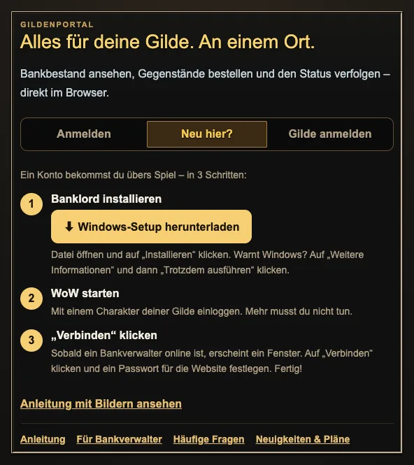
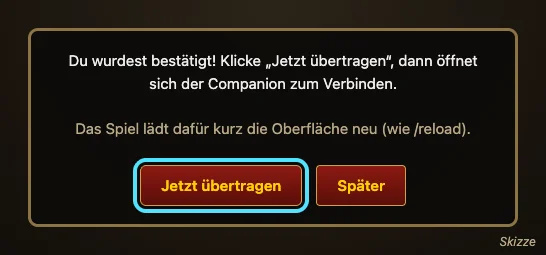
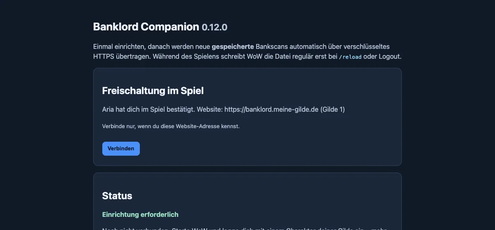
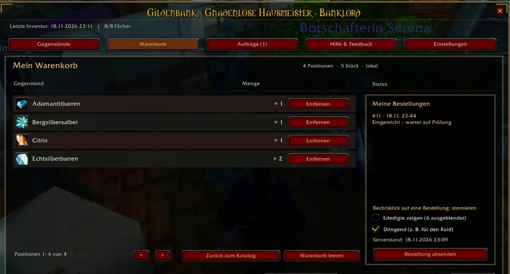
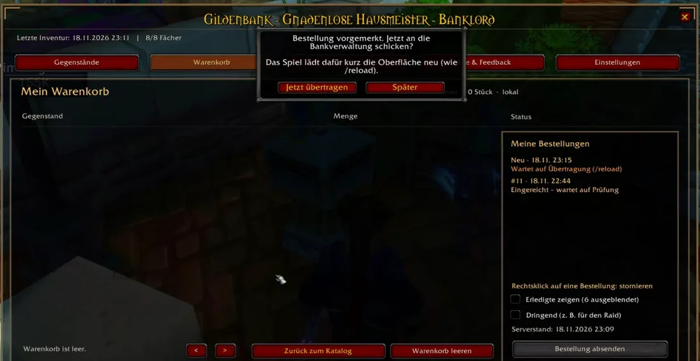
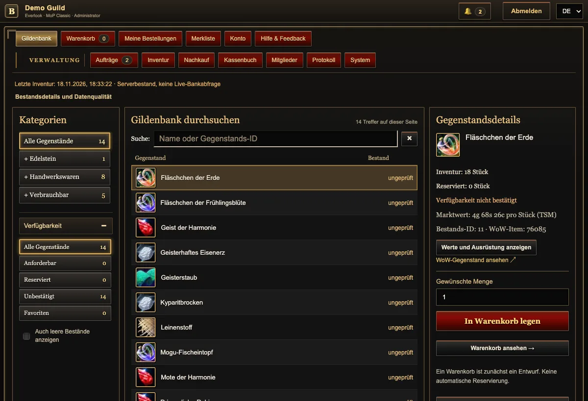
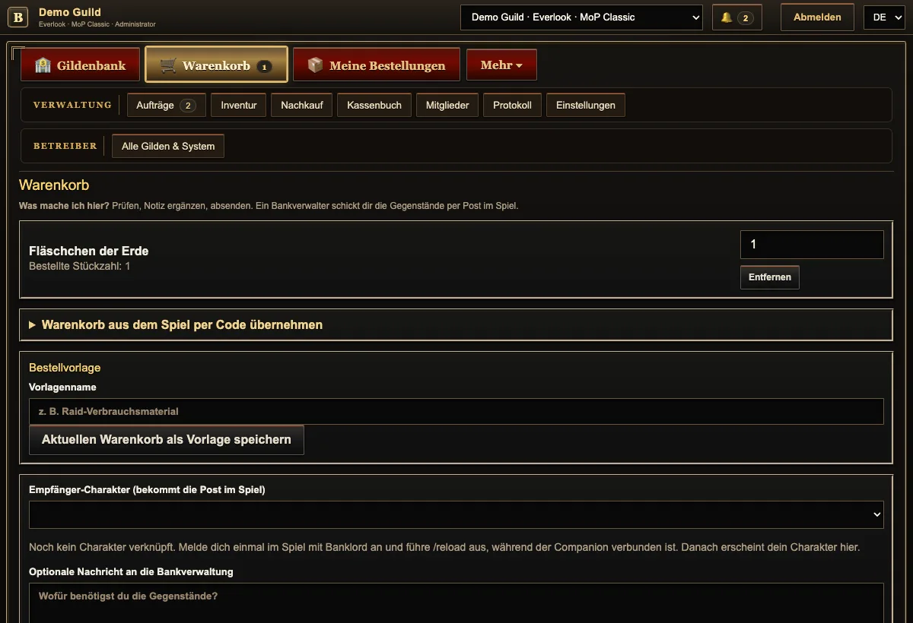
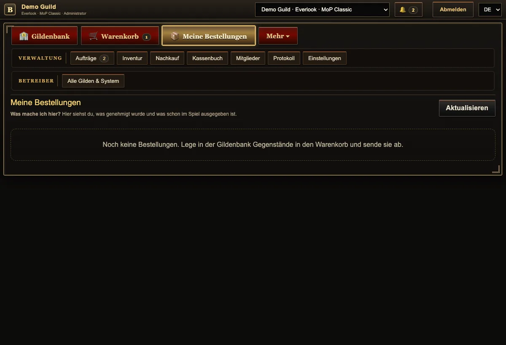

# Guide for members

[← Overview](README.en.md) · [Deutsch](mitglieder.md) · **English**

## Contents

1. [Set up once](#set-up-once)
2. [Ordering in game](#ordering-in-game)
3. [Ordering on the website](#ordering-on-the-website)
4. [What happens after ordering?](#what-happens-after-ordering)
5. [Help & Feedback](#help--feedback)
6. [In-game commands](#in-game-commands)

---

## Set up once

Takes about 5 minutes. All you need is your Windows PC and WoW. *(The pictures show the German interface; in English the buttons are labelled accordingly.)*

### Step 1: Download the setup

Open your guild's Banklord website. Right at the top it says **“New here? Ready in 3 steps”**. Click the big **“Download Windows setup”** button.

### Step 2: Start the setup

Open the downloaded file (usually at the bottom of the browser or in your **Downloads** folder).

Windows warns you the first time because Banklord is a small fan project without an expensive certificate ([why?](installation.en.md#windows-warns-about-an-unknown-app)). Click **① “More info”** and then **② “Run anyway”**.

### Step 3: Click install

The setup finds WoW by itself, everything is already ticked. **WoW must be closed.** Click **“Installieren / Aktualisieren”** (install / update) – done.

### Step 4: Start WoW

Start WoW as usual and log in with a character of your guild. **That is all you need to do.** The chat says: *“Unlock requested … you do not need to do anything.”*

### Step 5: Click “Transfer now”

As soon as a bank manager, officer or admin is online, their addon confirms you automatically. This window appears for you. Click **“Transfer now”**.

### Step 6: Click “Connect”

The **Banklord Companion** opens on your PC. Does it show your guild's website? Then click **“Verbinden”** (connect).

The first time, the website opens afterwards: choose e-mail, display name and a password (at least 14 characters – tip: three words with hyphens, e.g. *dragon-coffee-window*). **Done!**

### Not working?

| What you see | What to do |
|---|---|
| The game says “Not connected yet: download the Banklord setup …” | Steps 1 to 3 are still missing. Restart WoW afterwards. |
| Nothing happens for a long time | No bank manager is online yet. Just keep playing – it continues by itself as soon as one comes online. |
| The setup says WoW is still running | Close WoW and click install again. |
| The Companion shows “not confirmed yet” | The manager has to click **“Transfer now”** once. Your Companion keeps trying by itself. |
| WoW was already running during the install | Type `/reload` once in game. |

If none of this helps, write to us via **Help & feedback → Report a bug** on the website or `/bl help` in game.

### Fallback: invitation

If no manager is online for a longer time, an admin can create an invitation for you on the website under **Members**. Use it to register on the website, then connect the Companion under **Account**.

### Several characters or guilds

- **Several characters:** Just log in with each one once. Banklord remembers the characters and assigns them to the right guild.
- **Several guilds** with their own Banklord website: each guild is unlocked separately. In the Companion they are listed under **“Other guilds on this PC”**.

---

## Ordering in game

1. Open Banklord with `/banklord` or the minimap button.
2. Search for the item, enter the quantity and put it in the **cart**.
3. In a hurry, e.g. for the raid? Tick **“Urgent”** (or `/bl order urgent`).
4. Click **“Submit order”**.

5. A window appears: click **“Transfer now”**. The order goes to the bank managers right away. (If you click “Later”, it goes out the next time you log out.)

6. After about 25 seconds Banklord asks once more: click **“Load now”** – then “My orders” shows the website's status. (WoW only reads new data while loading.)

**“My orders”** lists only open orders. Ticking **“Show finished”** adds delivered, rejected and cancelled ones.

**Made a mistake?** Right-click the order on the right under **“My orders”** to cancel it (the hint is shown right below the list too). On the website use the cancel button of the order.

The stock shown in game is the state of the last guild bank scan. Items marked “reserved” have already been ordered by someone else.

## Ordering on the website

1. Sign in. Under **Guild bank** you see the stock with search and filters. Click an item, enter the quantity and click **“Add to cart”**.

2. Open the **cart**. Choose the **recipient character** – the bank manager mails the items to them. (Only characters you have logged in with Banklord at least once appear.)
3. In a hurry? Tick **“Urgent”**. Then send the order to the bank managers.

Under **My orders** you can always see how far your order has got.

## What happens after ordering?

| Status | Meaning |
|---|---|
| **Submitted** | The order has arrived and is waiting for a bank manager. |
| **Reserved** / **Partial** | The manager is holding the items (or some of them) for you. |
| **Issued** | The mail is on its way. Check your mailbox. |
| **Rejected** / **Cancelled** | The order will not be delivered. The reason is shown under **My orders**. |

You see news on the website under **Notifications** and in game after the next `/reload`. All times are shown in your local time.

- **Instant notice:** As soon as a bank manager sends your mail, Banklord says “Your order #… is on its way” in game – without `/reload`, if the recipient character is online.
- **Partial delivery:** If something is missing in the guild bank, the manager can send part of it already. The rest stays open and follows later.
- **Cancel:** In the Banklord window under **Cart → My orders** right-click the order, use `/banklord stornieren <no>` or the website. Items already sent stay with you.
- **Weekly limit:** If your guild set a weekly limit, the cart shows it. Above it the order is still accepted and an officer approves it.
- **Old orders:** The guild can have open orders cancelled automatically after a set number of days.
- **View only:** Items from locked guild bank tabs are visible but cannot be ordered.
- **Tooltip:** Hovering an item shows “Guild bank: 20” (from the last scan). On/off: `/banklord tooltip`.

---

## Help & Feedback

Something is stuck, you have an idea, or you would like Banklord in your language?

| Where | How |
|---|---|
| **In game** | `/banklord feedback` or the **Help & Feedback** tab in the Banklord window. Sent with the next `/reload`. |
| **Website** | **More → Help & feedback**. |

1. Choose **Report a bug**, **Suggest an idea** or **Request a language**.
2. Fill in the short form and click **Send**.
3. Under **My reports** you see whether your report was received, planned or done – and the answer.

The report goes straight to the Banklord project. Only what you enter and the version numbers are sent, no account or character data. An e-mail address for follow-up questions is optional.

---

## In-game commands

All commands start with `/banklord`. The commands are German words; the table lists what they do:

| Command | Effect |
|---|---|
| `/banklord` | Open or close the Banklord window |
| `liste`, `suche <name>` | List or search the stock in chat |
| `merken <item ID> <quantity>` | Put an item in the cart |
| `korb` | Show the cart |
| `bestellen` | Order the cart |
| `bestellen dringend` | Order the cart as urgent |
| `leeren` | Empty the cart |
| `senden <player>` | Hand your cart to a guildmate who uploads it for you (if you have no Companion) |
| `eingang`, `ausgang`, `erneut` | View handed-over carts or send them again |
| `status` | State of the addon and the last scan |
| `stornieren <no>` | Cancel your own open order |
| `bestellungen` | Open orders (bank managers only) |
| `einkauf` | Shopping list for Auctionator/TSM (bank managers only) |
| `kasse` | Cash book: guild bank gold and latest entries |
| `tooltip` | Guild bank count in tooltips on/off |
| `feedback` (or `help`) | Help & Feedback: report a bug, suggest an idea, request a language |
| `minimap` | Show or hide the minimap button |
| `lang de`, `lang en`, `lang auto` | Change the language |
