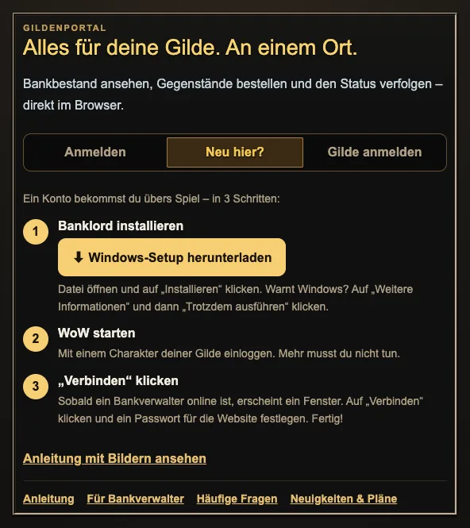
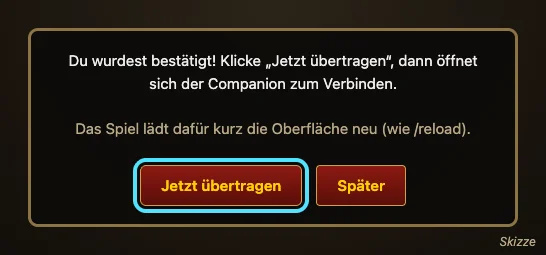
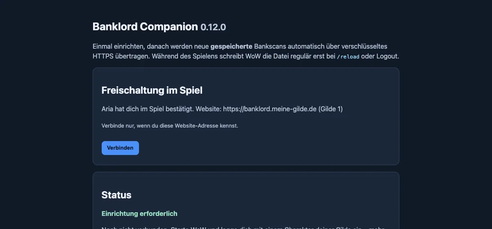
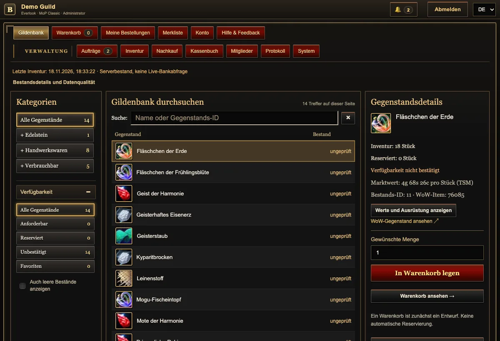
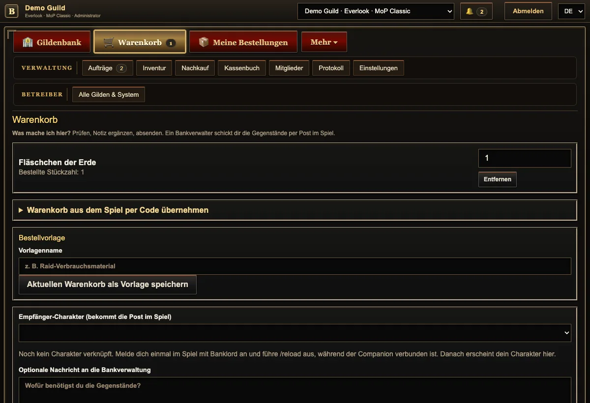
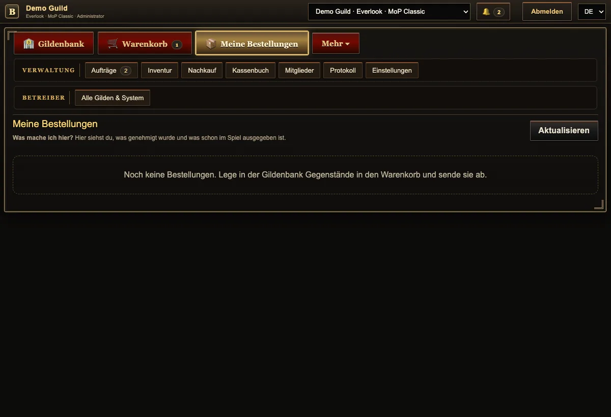

# Anleitung für Mitglieder

[← Übersicht](README.md) · **Deutsch** · [English](mitglieder.en.md)

## Inhalt

1. [Einmal einrichten](#einmal-einrichten)
2. [Bestellen im Spiel](#bestellen-im-spiel)
3. [Bestellen auf der Website](#bestellen-auf-der-website)
4. [Was passiert nach der Bestellung?](#was-passiert-nach-der-bestellung)
5. [Hilfe & Feedback](#hilfe--feedback)
6. [Befehle im Spiel](#befehle-im-spiel)

---

## Einmal einrichten

Dauert etwa 5 Minuten. Du brauchst nur deinen Windows-PC und WoW.

### Schritt 1: Setup herunterladen

Öffne die Banklord-Website deiner Gilde. Gleich oben steht **„Neu hier? In 3 Schritten startklar“**. Klicke auf den großen Knopf **„Windows-Setup herunterladen“**.

### Schritt 2: Setup starten

Öffne die heruntergeladene Datei (meist unten im Browser oder im Ordner **Downloads**).

Windows warnt beim ersten Mal, weil Banklord ein kleines Fanprojekt ohne teures Zertifikat ist ([warum?](installation.md#windows-warnt-vor-einer-unbekannten-app)). Klicke **① „Weitere Informationen“** und dann **② „Trotzdem ausführen“**.

### Schritt 3: Installieren klicken

Das Setup findet WoW von selbst, alles ist schon angehakt. **WoW muss dabei geschlossen sein.** Klicke **„Installieren / Aktualisieren“** – fertig.

### Schritt 4: WoW starten

Starte WoW wie immer und logge dich mit einem Charakter deiner Gilde ein. **Mehr musst du nicht tun.** Im Chat steht: *„Freischaltung angefragt … du musst nichts tun.“*

### Schritt 5: „Jetzt übertragen“ klicken

Sobald ein Bankverwalter, Offizier oder Admin online ist, bestätigt sein Addon dich von selbst. Bei dir erscheint dieses Fenster. Klicke **„Jetzt übertragen“**.

### Schritt 6: „Verbinden“ klicken

Auf dem PC öffnet sich der **Banklord Companion**. Steht dort die Website deiner Gilde? Dann klicke **„Verbinden“**.

Beim ersten Mal öffnet sich danach die Website: E-Mail, Anzeigename und ein Passwort festlegen (mindestens 14 Zeichen – Tipp: drei Wörter mit Bindestrich, z. B. *Drache-Kaffee-Fenster*). **Fertig!**

### Klappt nicht?

| Was du siehst | Was du tust |
|---|---|
| Im Spiel steht „Noch nicht verbunden: Lade … das Banklord-Setup herunter“ | Schritt 1 bis 3 fehlen noch. Danach WoW neu starten. |
| Lange passiert nichts | Es ist noch kein Bankverwalter online. Einfach weiterspielen – es geht von selbst weiter, sobald einer kommt. |
| Das Setup sagt „WoW läuft noch“ | WoW schließen und erneut **„Installieren / Aktualisieren“** klicken. |
| Der Companion zeigt „noch nicht bestätigt“ | Der Verwalter muss bei sich einmal **„Jetzt übertragen“** klicken. Dein Companion versucht es von selbst weiter. |
| WoW lief schon während der Installation | Im Spiel einmal `/reload` eingeben. |

Hilft das alles nicht, schreib uns über **Hilfe & Feedback → Fehler melden** auf der Website oder `/bl hilfe` im Spiel.

### Ausweichweg: Einladung

Ist längere Zeit kein Verwalter online, kann dir ein Admin auf der Website unter **Mitglieder** eine Einladung erstellen. Damit registrierst du dich auf der Website und verbindest danach den Companion unter **Konto**.

### Mehrere Charaktere oder Gilden

- **Mehrere Charaktere:** Einfach mit jedem einmal einloggen. Banklord merkt sich die Charaktere und ordnet sie der richtigen Gilde zu.
- **Mehrere Gilden** mit eigener Banklord-Website: Jede Gilde wird einzeln freigeschaltet. Im Companion stehen sie unter **„Weitere Gilden auf diesem PC“**.

---

## Bestellen im Spiel

1. Öffne Banklord mit `/banklord` oder über den Knopf an der Minikarte.
2. Suche den Gegenstand, gib die Menge ein und lege ihn in den **Warenkorb**.
3. Eilt es, z. B. für den Raid? Hake **„Dringend“** an (oder `/bl bestellen dringend`).
4. Klicke **„Bestellen“**.

5. Es erscheint ein Fenster: **„Jetzt übertragen“** klicken. Damit geht die Bestellung sofort an die Bankverwaltung. (Klickst du „Später“, geht sie beim nächsten Ausloggen raus.)

Der Bestand im Spiel ist der Stand vom letzten Scan der Gildenbank. Was „reserviert“ ist, hat schon jemand anderes bestellt.

## Bestellen auf der Website

1. Melde dich an. Unter **Gildenbank** siehst du den Bestand mit Suche und Filtern. Klicke einen Gegenstand an, gib die Menge ein und klicke **„In Warenkorb legen“**.

2. Öffne den **Warenkorb**. Wähle den **Empfänger-Charakter** – an ihn schickt der Bankverwalter die Post. (Es erscheinen nur Charaktere, mit denen du dich einmal im Spiel mit Banklord eingeloggt hast.)
3. Eilt es? Hake **„Dringend“** an. Dann **„Bestellung an die Bankverwaltung senden“**.

Unter **Meine Bestellungen** siehst du jederzeit, wie weit deine Bestellung ist.

## Was passiert nach der Bestellung?

| Status | Bedeutung |
|---|---|
| **Eingereicht** | Die Bestellung ist da und wartet auf einen Bankverwalter. |
| **Reserviert** / **Teilweise** | Der Verwalter hält die Gegenstände (oder einen Teil) für dich zurück. |
| **Ausgegeben** | Die Post ist unterwegs. Schau in deinen Briefkasten. |
| **Abgelehnt** / **Storniert** | Die Bestellung wird nicht ausgeliefert. Der Grund steht unter **Meine Bestellungen**. |

Neuigkeiten siehst du auf der Website unter **Mitteilungen** und im Spiel nach dem nächsten `/reload`. Alle Zeiten werden in deiner Ortszeit angezeigt.

- **Sofort-Hinweis:** Sobald ein Bankverwalter deine Post abschickt, meldet Banklord im Spiel „Deine Bestellung #… ist unterwegs“ – auch ohne `/reload`, wenn der Empfänger-Charakter online ist.
- **Teillieferung:** Fehlt etwas in der Gildenbank, kann der Verwalter schon einen Teil schicken. Der Rest bleibt offen und kommt später.
- **Stornieren:** Im Banklord-Fenster unter **Warenkorb → Meine Bestellungen** mit Rechtsklick auf die Bestellung, mit `/banklord stornieren <Nr>` oder auf der Website. Bereits Verschicktes bleibt bei dir.
- **Wochenlimit:** Hat deine Gilde ein Wochenlimit festgelegt, siehst du es im Warenkorb. Darüber wird die Bestellung trotzdem angenommen, ein Offizier gibt sie frei.
- **Alte Bestellungen:** Die Gilde kann offene Bestellungen nach einer festen Zahl von Tagen automatisch stornieren lassen.
- **Nur ansehen:** Gegenstände aus gesperrten Gildenbank-Tabs siehst du, kannst sie aber nicht bestellen.
- **Tooltip:** Fährst du über einen Gegenstand, zeigt Banklord „Gildenbank: 20“ (aus dem letzten Scan). Ein/aus: `/banklord tooltip`.

---

## Hilfe & Feedback

Etwas klemmt, du hast eine Idee oder möchtest Banklord in deiner Sprache?

| Wo | So geht's |
|---|---|
| **Im Spiel** | `/banklord feedback` oder Reiter **Hilfe & Feedback** im Banklord-Fenster. Gesendet wird beim nächsten `/reload`. |
| **Website** | Reiter **Hilfe & Feedback**. |

1. Wähle **Fehler melden**, **Idee vorschlagen** oder **Sprache anfragen**.
2. Fülle das kurze Formular aus und klicke **Absenden**.
3. Unter **Meine Meldungen** siehst du, ob deine Meldung eingegangen, geplant oder erledigt ist – und die Antwort.

Die Meldung geht direkt an das Banklord-Projekt. Mitgeschickt werden nur deine Angaben und die Versionsnummern, keine Konto- oder Charakterdaten. Eine E-Mail für Rückfragen ist freiwillig.

---

## Befehle im Spiel

Alle Befehle beginnen mit `/banklord`:

| Befehl | Wirkung |
|---|---|
| `/banklord` | Banklord-Fenster öffnen oder schließen |
| `liste`, `suche <Name>` | Bestand im Chat auflisten oder durchsuchen |
| `merken <Item-ID> <Menge>` | Gegenstand in den Warenkorb legen |
| `korb` | Warenkorb anzeigen |
| `bestellen` | Warenkorb bestellen |
| `bestellen dringend` | Warenkorb als dringend bestellen |
| `leeren` | Warenkorb leeren |
| `senden <Spieler>` | Warenkorb an einen Mitspieler übergeben, der ihn für dich hochlädt (falls du keinen Companion hast) |
| `eingang`, `ausgang`, `erneut` | Übergebene Warenkörbe ansehen oder erneut senden |
| `status` | Zustand von Addon und letztem Scan |
| `stornieren <Nr>` | Eigene offene Bestellung stornieren |
| `bestellungen` | Offene Bestellungen (nur Bankverwalter) |
| `einkauf` | Einkaufsliste für Auctionator/TSM (nur Bankverwalter) |
| `kasse` | Kassenbuch: Gold der Gildenbank und letzte Einträge |
| `tooltip` | Gildenbank-Bestand in Tooltips ein/aus |
| `feedback` | Hilfe & Feedback: Fehler melden, Idee vorschlagen, Sprache anfragen |
| `minimap` | Minikarten-Knopf ein- oder ausblenden |
| `lang de`, `lang en`, `lang auto` | Sprache umstellen |
