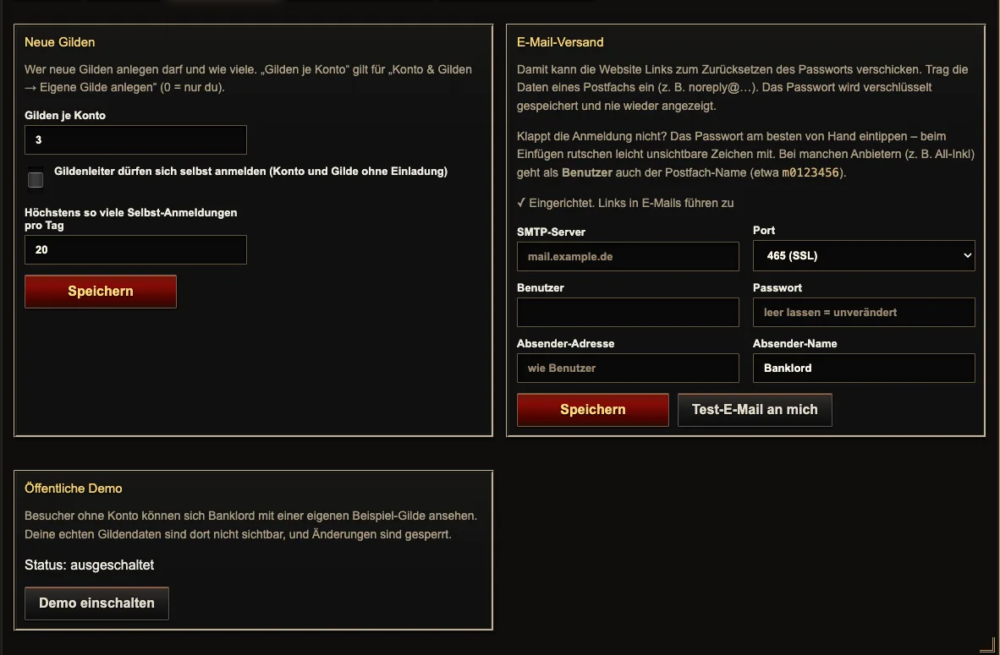
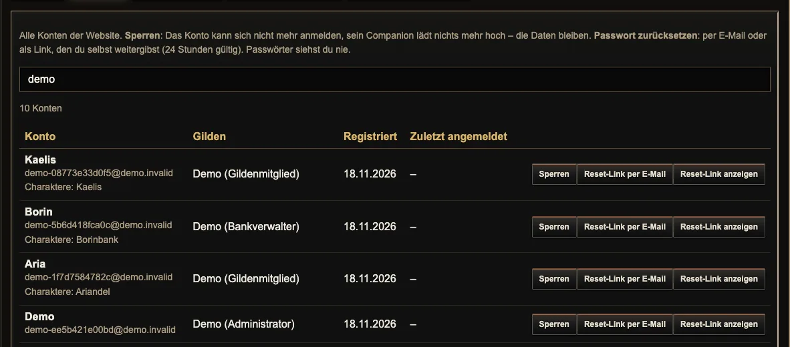

# Self-hosting Banklord

[← Overview](README.en.md) · [Deutsch](selbst-hosten.md) · **English**

Any guild may run Banklord free of charge on its own web space ([license](../LICENSE-ADDITIONAL-PERMISSIONS.md)).

> You don't want to run your own server? Then simply use our website: [Guide for guild leaders](gildenleiter.en.md).

## Requirements

| | Minimum |
|---|---|
| PHP | 8.2 with `pdo_mysql`, `sodium`, `zip` |
| Database | MariaDB 10.6+ or MySQL 8 |
| Web server | Apache or nginx, **HTTPS** |
| Storage | about 50 MB plus database |

## Setup

1. **Create a database** at your host (empty).
2. **Upload the files:** the `backend/` folder from the [latest release](https://github.com/lastrevolution0410/banklord/releases) (web package). The domain's **document root** must point to `backend/public`.
3. **Open the website.** The setup page appears. Enter database access, guild name, realm, game version and your admin account – done. You can still change the game version under **System** while the guild has no stock.

The setup page only exists until Banklord is configured. Settings are stored in `backend/private/config.local.php`. Optional keys are shown in [`backend/config.local.example.php`](../backend/config.local.example.php).

## First steps as admin

1. Under **Members**, choose the bank managers (role *bank manager* or *officer*).
2. The bank managers install the setup from your website. From then on they unlock new members automatically in game ([how?](bankverwalter.en.md#confirming-new-members)).
3. A bank manager opens the guild bank in game once and does `/reload` – the first stock appears on the website.

## Updates

The website updates itself from the official, signed release channel:

- Check at most every 6 hours, signature verification, then a **backup of database and files**, then installation including database changes.
- Status and “Check now” under **Operator → Updates & releases**.
- In `config.local.php`:
  - `'UPDATE_AUTO' => 'off'` – do not install automatically (the button under Operator → Updates & releases still works).
  - `'UPDATE_SOURCE' => 'off'` – never contact the official channel.

Addon and desktop app fetch their updates themselves; you do not need to do anything.

## Operator area

As the operator you additionally see **Operator → All guilds & system** on the website.

### Settings

Under **Operator → Settings** you decide:

- **Guilds per account:** how many guilds an account may set up itself.
- **Guild leaders may sign up on their own:** when ticked, strangers get the **“Register guild”** tab on the start page and create account and guild without an invitation (off by default). What they do next is in the [guide for guild leaders](gildenleiter.en.md).
- **Self sign-ups per day:** upper limit against abuse.

### Sending e-mail

Needed for **“Forgot password?”**. Without e-mail sending that option is simply hidden.

1. Open **Operator → Settings → Sending e-mail**.
2. Enter SMTP server, port (**465 SSL** or **587 STARTTLS**), user and password of a mailbox. Best **type the password by hand**. With All-Inkl the mailbox name such as `m0123456` also works as user.
3. Click **“Save”**, then **“Test e-mail to me”**.

The password is stored encrypted in the database, the key in `private/mail.key`. That file belongs in your backup.

### Accounts

Under **Operator → Accounts** you see every account with name, e-mail, guilds, characters and last sign-in. The search also finds character names.

- **Lock:** sign-in and Companion stop working, the data stays. **Unlock** reverses it.
- **Reset password:** by e-mail or as a link you pass on yourself (valid for 24 hours). You never see passwords.
- Other operators and your own account are excluded.

### Guilds

Under **Operator → Guilds** you see all guilds and can **lock** a guild (e.g. in case of abuse). Its data is kept.

## Help & Feedback

Your website forwards your members' reports (bugs, ideas, language requests) to the Banklord project – to the same address as the update channel, without account or character data.

- `'FEEDBACK' => 'off'` – turn reports off.
- With `'UPDATE_SOURCE' => 'off'` reports stay on your own website; admins then see them under **Help & Feedback → Inbox**.

## Backups

Banklord makes a backup before every update. Also recommended: turn on your host's regular database backup.

## Own update channel

Anyone who wants to distribute their own builds needs their own signing key – see [Development](entwicklung.en.md#own-releases).
