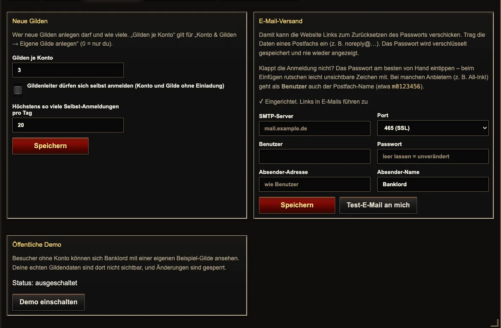
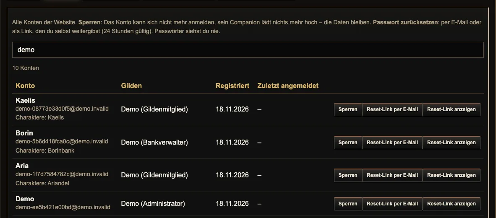

# Banklord selbst hosten

[← Übersicht](README.md) · **Deutsch** · [English](selbst-hosten.en.md)

Banklord darf jede Gilde kostenlos auf ihrem eigenen Webspace betreiben ([Lizenz](../LICENSE-ADDITIONAL-PERMISSIONS.md)).

> Du willst keinen eigenen Server betreiben? Dann nutze einfach unsere Website: [Anleitung für Gildenleiter](gildenleiter.md).

## Voraussetzungen

| | Mindestens |
|---|---|
| PHP | 8.2 mit `pdo_mysql`, `sodium`, `zip` |
| Datenbank | MariaDB 10.6+ oder MySQL 8 |
| Webserver | Apache oder nginx, **HTTPS** |
| Speicher | ca. 50 MB plus Datenbank |

## Einrichten

1. **Datenbank** beim Hoster anlegen (leer).
2. **Dateien hochladen:** den Ordner `backend/` aus dem [neuesten Release](https://github.com/lastrevolution0410/banklord/releases) (Web-Paket). Das **Document Root** der Domain muss auf `backend/public` zeigen.
3. **Website öffnen.** Die Einrichtungsseite erscheint. Datenbank-Zugang, Gildenname, Realm, Spielversion und dein Admin-Konto eintragen – fertig. Die Spielversion lässt sich unter **System** noch ändern, solange die Gilde keinen Bestand hat.

Die Einrichtungsseite existiert nur, bis Banklord konfiguriert ist. Die Einstellungen liegen in `backend/private/config.local.php`. Optionale Schlüssel zeigt [`backend/config.local.example.php`](../backend/config.local.example.php).

## Erste Schritte als Admin

1. Unter **Mitglieder** die Bankverwalter festlegen (Rolle *Bankverwalter* oder *Offizier*).
2. Die Bankverwalter installieren das Setup von deiner Website. Ab dann schalten sie neue Mitglieder automatisch im Spiel frei ([wie?](bankverwalter.md#neue-mitglieder-bestätigen)).
3. Ein Bankverwalter öffnet einmal die Gildenbank im Spiel und macht `/reload` – der erste Bestand erscheint auf der Website.

## Updates

Die Website aktualisiert sich selbst aus dem offiziellen, signierten Release-Kanal:

- Prüfung höchstens alle 6 Stunden, Signaturprüfung, danach **Backup von Datenbank und Dateien**, dann Installation inklusive Datenbank-Änderungen.
- Status und „Jetzt prüfen“ unter **Betreiber → Updates & Releases**.
- In `config.local.php`:
  - `'UPDATE_AUTO' => 'off'` – nicht automatisch installieren (Knopf unter Betreiber → Updates & Releases geht weiter).
  - `'UPDATE_SOURCE' => 'off'` – nie den offiziellen Kanal kontaktieren.

Addon und Desktop-App holen ihre Updates selbst; dafür musst du nichts tun.

## Betreiber-Bereich

Als Betreiber siehst du auf der Website zusätzlich **Betreiber → Alle Gilden & System**.

### Einstellungen

Unter **Betreiber → Einstellungen** legst du fest:

- **Gilden je Konto:** wie viele Gilden ein Konto selbst anlegen darf.
- **Gildenleiter dürfen sich selbst anmelden:** Mit Haken bekommen Fremde auf der Startseite den Reiter **„Gilde anmelden“** und legen Konto und Gilde ohne Einladung an (standardmäßig aus). Was sie dann tun, steht in der [Anleitung für Gildenleiter](gildenleiter.md).
- **Selbst-Anmeldungen pro Tag:** Obergrenze gegen Missbrauch.

### E-Mail-Versand

Nötig für **„Passwort vergessen?“**. Ohne E-Mail-Versand ist der Punkt einfach ausgeblendet.

1. **Betreiber → Einstellungen → E-Mail-Versand** öffnen.
2. SMTP-Server, Port (**465 SSL** oder **587 STARTTLS**), Benutzer und Passwort eines Postfachs eintragen. Das Passwort am besten **von Hand eintippen**. Bei All-Inkl geht als Benutzer auch der Postfach-Name wie `m0123456`.
3. **„Speichern“**, dann **„Test-E-Mail an mich“**.

Das Passwort liegt verschlüsselt in der Datenbank, der Schlüssel in `private/mail.key`. Diese Datei gehört ins Backup.

### Konten

Unter **Betreiber → Konten** siehst du alle Konten mit Name, E-Mail, Gilden, Charakteren und letzter Anmeldung. Die Suche findet auch Charakternamen.

- **Sperren:** Anmeldung und Companion gehen nicht mehr, die Daten bleiben. **Entsperren** macht es rückgängig.
- **Passwort zurücksetzen:** per E-Mail oder als Link, den du selbst weitergibst (24 Stunden gültig). Passwörter siehst du nie.
- Andere Betreiber und dein eigenes Konto sind davon ausgenommen.

### Gilden

Unter **Betreiber → Gilden** siehst du alle Gilden und kannst eine Gilde **sperren** (z. B. bei Missbrauch). Ihre Daten bleiben erhalten.

## Hilfe & Feedback

Meldungen deiner Mitglieder (Fehler, Ideen, Sprachwünsche) leitet deine Website an das Banklord-Projekt weiter – an dieselbe Adresse wie der Update-Kanal, ohne Konto- oder Charakterdaten.

- `'FEEDBACK' => 'off'` – Meldungen ausschalten.
- Mit `'UPDATE_SOURCE' => 'off'` bleiben Meldungen auf deiner eigenen Website; Admins sehen sie dann unter **Hilfe & Feedback → Posteingang**.

## Backups

Vor jedem Update legt Banklord ein Backup an. Zusätzlich empfohlen: das regelmäßige Datenbank-Backup deines Hosters einschalten.

## Eigener Update-Kanal

Wer eigene Builds verteilen will, braucht einen eigenen Signaturschlüssel – siehe [Entwicklung](entwicklung.md#eigene-releases).
